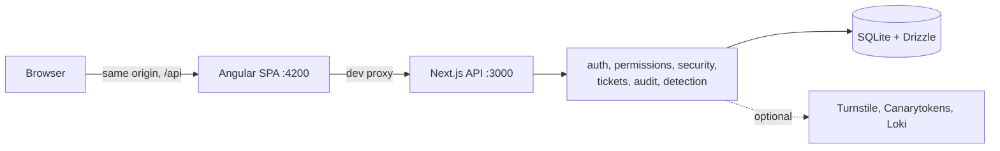
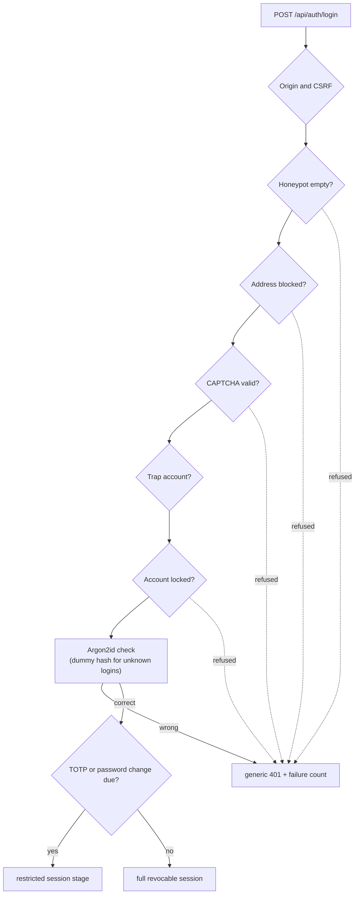

# SecureDesk

[](https://github.com/IgorK834/SecureDesk/actions/workflows/ci.yml)
[](LICENSE)
[](.nvmrc)

**SecureDesk** is an internal helpdesk built to show a complete security path end to end: Argon2id
passwords, revocable cookie sessions with CSRF protection, role- and object-level authorization,
optional TOTP, layered login-abuse defences, honeytokens, and a tamper-evident audit log with
detection rules and alerts. Staff and guests file tickets, a manager assigns them, an employee
works them, and an administrator runs the security side.

[](docs/report-evidence/demo/securedesk-ticket-workflow.webm)

**[Watch the 61-second walkthrough](docs/report-evidence/demo/securedesk-ticket-workflow.webm)**
and see [docs/demos.md](docs/demos.md) for the steps behind every screenshot.

## Features

- **Authentication and sessions.** Argon2id hashing, one-time temporary passwords with a forced
  first change, server-side sessions with idle and absolute expiry, optional TOTP
  (SEC-01 to 23; [design](docs/architecture.md)).
- **Authorization.** Four roles and 26 permissions, enforced in the API; a ticket you may not read
  answers `404` like one that does not exist (SEC-15 to 17; [matrix](docs/permissions.md)).
- **Abuse defences.** Honeypot, address blocks, per-account lockout, local and Turnstile or
  reCAPTCHA challenges, honeytoken traps (SEC-27 to 60; [threat model](docs/threat-model.md)).
- **Security events.** Administrators review, acknowledge and clear alerts; `npm run bot-sim` replays
  attacks against a local instance (SEC-58, SEC-61; [Canarytokens](docs/canarytokens.md)).
- **Audit log.** Append-only table whose rows are hash-chained, with browsing, export, an
  integrity check and a tamper demo (SEC-63 to 87; [runbook](docs/audit-log.md)).
- **Detection and shipping.** Two detection rules raise alerts into the log and an alert file;
  optional shipping to Grafana Loki (SEC-88 to 95; [Loki guide](docs/loki.md)).

## Roles

| Role (seeded accounts)                  | Can do                                                                                 | Cannot do                                      |
| --------------------------------------- | -------------------------------------------------------------------------------------- | ---------------------------------------------- |
| **Administrator** (`ADMIN`)             | Manage accounts, settings, security events, address blocks; read, export, verify audit | Any ticket action (every ticket route `403`)   |
| **Manager** (`manager1`, `manager2`)    | Create, read all, assign to an Employee, set status of any ticket                      | Manage users or settings                       |
| **Employee** (`employee1`, `employee2`) | Create tickets, read own or assigned, set status of assigned                           | Assign tickets, see colleagues' tickets        |
| **Guest** (`guest1`, `guest2`)          | Create tickets, read their own                                                         | Change status, assign, anything administrative |

## Security controls at a glance

<!-- controls:start -->

96 automated scenarios in [`docs/testing.md`](docs/testing.md) prove the controls below; `npm test` fails if one loses its test.

| Control                                               | Implemented in                                                                                                                                                               | Scenarios                          |
| ----------------------------------------------------- | ---------------------------------------------------------------------------------------------------------------------------------------------------------------------------- | ---------------------------------- |
| Argon2id password storage                             | [`auth/password-hasher.ts`](apps/backend/src/server/auth/password-hasher.ts)                                                                                                 | SEC-03                             |
| Uniform login failures (no account enumeration)       | [`auth/login-service.ts`](apps/backend/src/server/auth/login-service.ts)                                                                                                     | SEC-01, SEC-02, SEC-34             |
| Temporary credentials and forced first change         | [`auth/temporary-password.ts`](apps/backend/src/server/auth/temporary-password.ts)                                                                                           | SEC-04 to 08                       |
| Password policy and history                           | [`auth/password-policy.ts`](apps/backend/src/server/auth/password-policy.ts)                                                                                                 | SEC-09 to 14                       |
| Role and object-level authorization                   | [`permissions/matrix.ts`](apps/backend/src/server/permissions/matrix.ts), [`tickets/policy.ts`](apps/backend/src/server/tickets/policy.ts)                                   | SEC-15 to 17, SEC-28, SEC-29       |
| Revocable sessions, idle and absolute timeouts        | [`auth/session-service.ts`](apps/backend/src/server/auth/session-service.ts)                                                                                                 | SEC-18 to 23, SEC-30               |
| CSRF protection                                       | [`security/csrf.ts`](apps/backend/src/server/security/csrf.ts)                                                                                                               | SEC-24                             |
| SQL injection and XSS resistance                      | [`security/sql-lint.test.ts`](apps/backend/src/server/security/sql-lint.test.ts)                                                                                             | SEC-25, SEC-26                     |
| Rate limiting and account lockout                     | [`security/rate-limiter.ts`](apps/backend/src/server/security/rate-limiter.ts), [`auth/login-guard.ts`](apps/backend/src/server/auth/login-guard.ts)                         | SEC-27, SEC-31 to 33, SEC-35 to 39 |
| CAPTCHA (local, Turnstile, reCAPTCHA)                 | [`captcha/index.ts`](apps/backend/src/server/security/captcha/index.ts)                                                                                                      | SEC-40 to 48                       |
| Honeypot field and honeytokens                        | [`security/honeytokens.ts`](apps/backend/src/server/security/honeytokens.ts)                                                                                                 | SEC-49 to 54                       |
| Address blocks and password-spraying detection        | [`security/ip-block-service.ts`](apps/backend/src/server/security/ip-block-service.ts), [`security/attempt-tracker.ts`](apps/backend/src/server/security/attempt-tracker.ts) | SEC-55 to 57, SEC-59, SEC-60       |
| Security events for administrators                    | [`security/events.ts`](apps/backend/src/server/security/events.ts), [`security/event-admin.ts`](apps/backend/src/server/security/event-admin.ts)                             | SEC-58                             |
| Safe attack simulation and production start-up checks | [`bot-sim/guards.ts`](scripts/bot-sim/guards.ts), [`src/instrumentation.ts`](apps/backend/src/instrumentation.ts)                                                            | SEC-61, SEC-62                     |
| Audit recording of security-relevant actions          | [`audit/append.ts`](apps/backend/src/server/audit/append.ts), [`audit/events.ts`](apps/backend/src/server/audit/events.ts)                                                   | SEC-63 to 73                       |
| Append-only, hash-chained audit table                 | [`audit/chain.ts`](apps/backend/src/server/audit/chain.ts), [`migrations/0007_protect_audit_log.sql`](apps/backend/src/server/db/migrations/0007_protect_audit_log.sql)      | SEC-74 to 78                       |
| Audit log browsing and export                         | [`audit/queries.ts`](apps/backend/src/server/audit/queries.ts), [`audit/export.ts`](apps/backend/src/server/audit/export.ts)                                                 | SEC-79 to 81                       |
| Integrity verification and tamper detection           | [`audit/verify.ts`](apps/backend/src/server/audit/verify.ts), [`audit/anchor.ts`](apps/backend/src/server/audit/anchor.ts)                                                   | SEC-82 to 87, SEC-96               |
| Detection rules and alerts                            | [`detection/engine.ts`](apps/backend/src/server/detection/engine.ts), [`alerts/file-alert-dispatcher.ts`](apps/backend/src/server/alerts/file-alert-dispatcher.ts)           | SEC-88 to 93                       |
| Canarytokens webhook and Loki shipping                | [`security/canary-webhook.ts`](apps/backend/src/server/security/canary-webhook.ts), [`audit/ship-loki.ts`](apps/backend/src/server/audit/ship-loki.ts)                       | SEC-94, SEC-95                     |

<!-- controls:end -->

## Architecture



A login runs the defences in a fixed order ([`login-guard.ts`](apps/backend/src/server/auth/login-guard.ts)),
and every outcome is audited:



## Quick start

Needs Node.js 24 and `openssl`. [docs/running.md](docs/running.md) has every step in detail,
including how to generate the secrets and read the seeded passwords.

```bash
npm ci && cp .env.example .env     # then replace the placeholder secrets (docs/running.md)
npm run db:migrate && npm run db:seed
npm run dev                        # app on http://localhost:4200, API on :3000
```

Sign in at <http://localhost:4200/login> with a seeded account (`ADMIN`, `manager1`, `employee1`,
`guest1` and so on) and reverse the characters of the CAPTCHA image.

## Development

```bash
npm run lint && npm run typecheck && npm run format:check
npm test                  # unit and integration tests, 80% coverage gate, SEC traceability
npm run test:e2e          # Playwright, isolated database (npx playwright install chromium once)
```

Stack: Angular (standalone components), Next.js API routes, SQLite with Drizzle migrations, strict
TypeScript, npm workspaces, ESLint, Prettier, Vitest and Playwright. Contributing:
[CONTRIBUTING.md](CONTRIBUTING.md).

## Documentation

- [Running, building and testing](docs/running.md) and [demonstrations](docs/demos.md)
- [Architecture and security design](docs/architecture.md), [threat model](docs/threat-model.md)
- [Database schema](docs/database-schema.md), [permission matrix](docs/permissions.md)
- [Test traceability](docs/testing.md), [report evidence](docs/report-evidence/README.md)
- [Audit log runbook](docs/audit-log.md), [Canarytokens](docs/canarytokens.md), [Loki](docs/loki.md)
- [Security policy](SECURITY.md), [repository settings](docs/repo-settings.md)
- [Course backlogs and reports](docs/course): the original assignment work and the roadmap

## Status and limitations

SecureDesk is a learning project and is **not certified or intended for production use**. Its
documented limits: a single-process SQLite deployment, a process-local rate limiter and CAPTCHA
circuit breaker, and a local image CAPTCHA that is weak against OCR
([threat model](docs/threat-model.md#scope-and-residual-risk)). Two hosted Canarytokens
notification screenshots need the manual procedure in [docs/canarytokens.md](docs/canarytokens.md).

## License

[MIT](LICENSE). Report vulnerabilities privately as described in [SECURITY.md](SECURITY.md).
