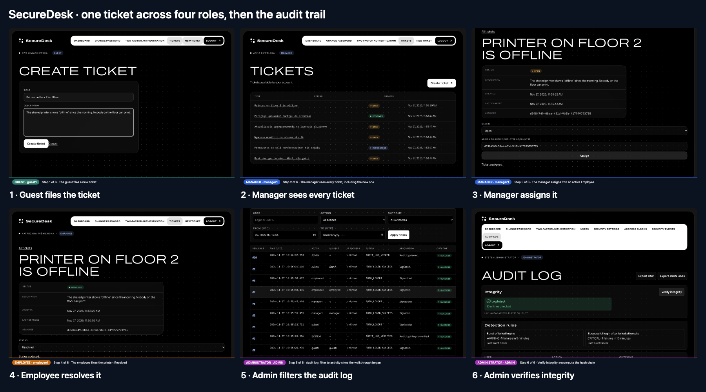
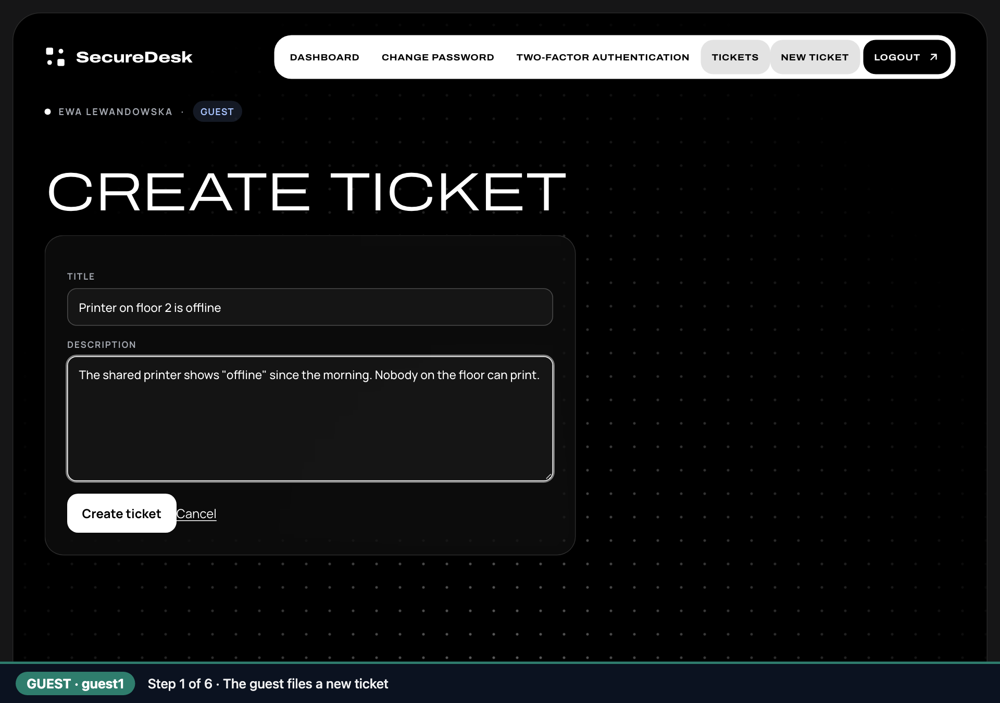
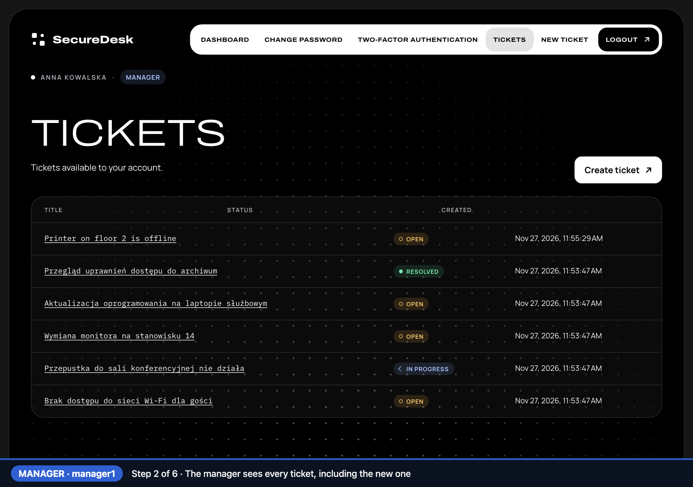
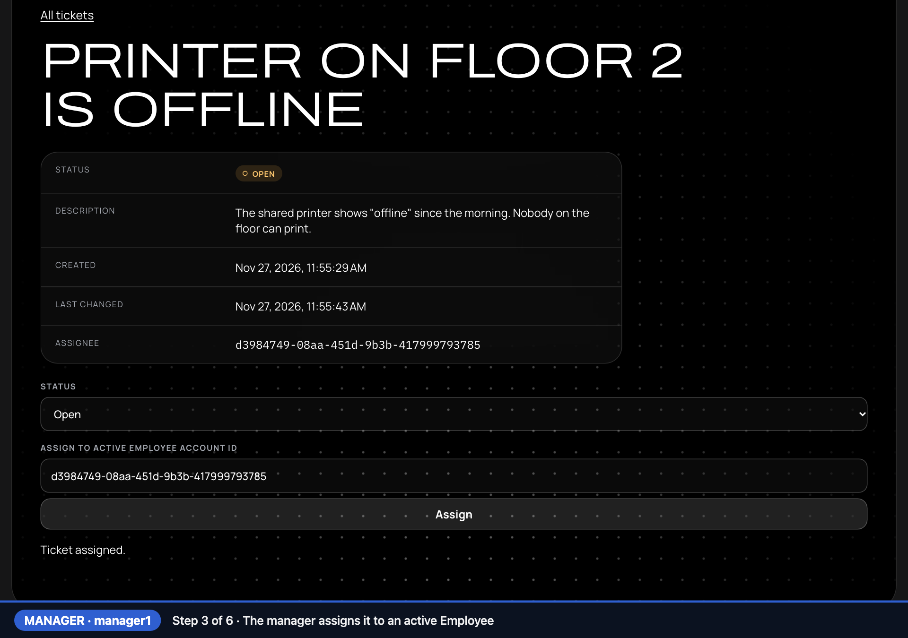
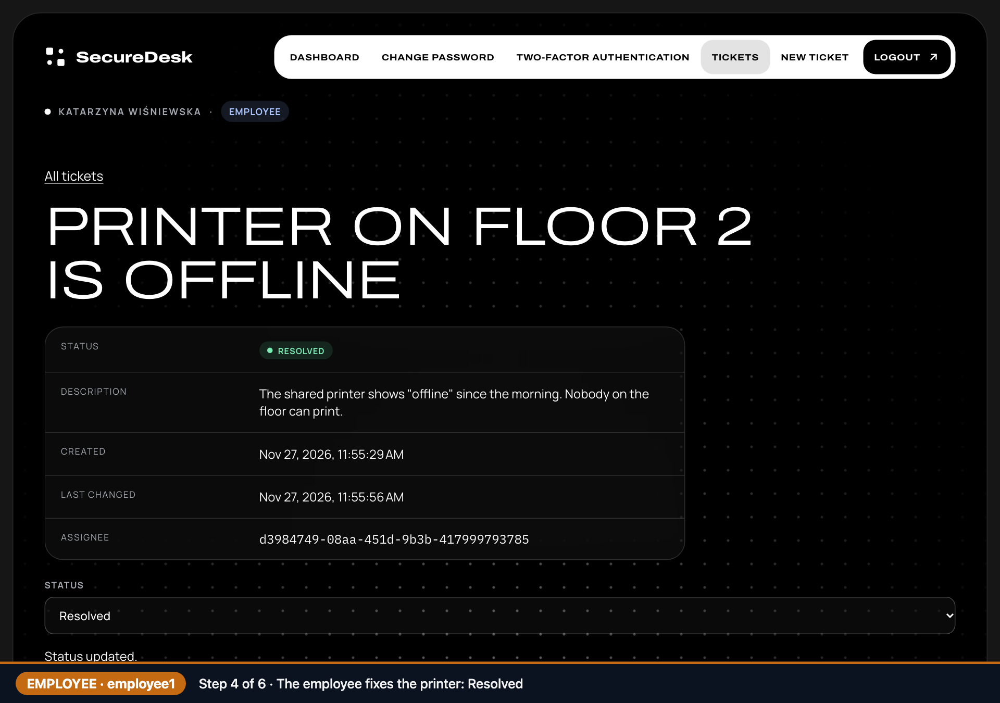
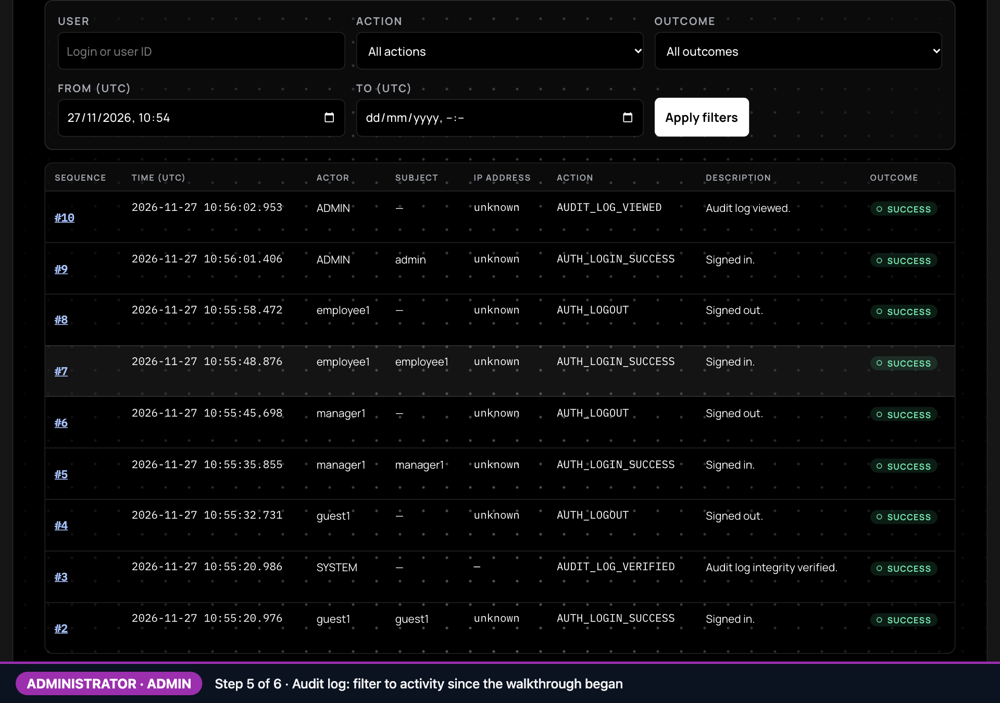
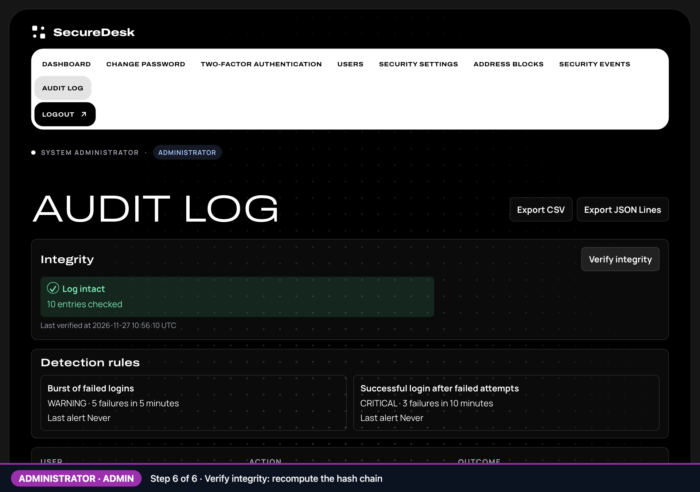

# SecureDesk

**SecureDesk** is a small internal helpdesk built as an academic project for a **Cybersecurity**
course. Staff and guests file tickets, a manager assigns them, an employee works them, and an
administrator manages accounts and security settings. The point of the project is that the whole
security path is usable end to end: authentication, forced and ordinary password changes, revocable
cookie sessions, CSRF protection, role-based access control (RBAC), ticket object authorization,
optional TOTP two-factor authentication, layered login-abuse protection, two CAPTCHA providers,
honeytoken alerts and a tamper-evident audit log. It is **not intended for production use**.

## Demo: one ticket, four roles, then the audit trail

[](docs/report-evidence/demo/securedesk-ticket-workflow.webm)

**[Watch the 61-second recording](docs/report-evidence/demo/securedesk-ticket-workflow.webm)**
(WebM, 1.7 MB, no audio). It is a real run of the app against a disposable SQLite database that
holds only synthetic accounts and tickets. A coloured bar at the bottom of the window names the
signed-in role and the current step, so every role switch is visible. You will see:

1. A **guest** signs in and files the ticket "Printer on floor 2 is offline". The guest's list
   contains only their own tickets.
2. A **manager** signs in, sees every ticket including the new one, and assigns it to `employee1`.
3. The assigned **employee** signs in, sees the ticket, sets it to _In progress_ and then _Resolved_.
4. The **administrator** signs in (the administrator has no ticket access), opens the audit log,
   filters it to the time window of the walkthrough and runs **Verify integrity**, which reports
   _Log intact_.

Notes on the recording: the login form shows its real CAPTCHA image, but the script typed the
test-only answer `TEST-SOLVED` (`CAPTCHA_TEST_MODE=true`, rejected in production) so the run could be
automated; in a normal run you type the characters of the image in reverse. Ticket creation,
assignment and status changes are not audit events (see
[What the application does](#what-the-application-does)), so the filtered log shows the
sign-ins and sign-outs of the walkthrough, not the ticket edits themselves. Ticket timestamps are shown
in the browser's local time, audit timestamps in UTC.

| Step | Screenshot                                                                                                                                                                                                                  | What it shows                                                                                                               |
| ---- | --------------------------------------------------------------------------------------------------------------------------------------------------------------------------------------------------------------------------- | --------------------------------------------------------------------------------------------------------------------------- |
| 1    |                                                                     | Any role with `tickets:create` may file a ticket. The creator is always the signed-in user and the status starts as _Open_. |
| 2    |                                                       | A manager reads every ticket. A guest saw only their own, an employee sees only created or assigned tickets.                |
| 3    |                                                  | Only a manager can assign, and only to an active Employee account.                                                          |
| 4    |                                                                | An employee may change the status of tickets assigned to them, not of other people's.                                       |
| 5    |  | The administrator filters the append-only audit log by time. The earlier database-seed entry is excluded.                   |
| 6    |                                                                | **Verify integrity** recomputes the hash chain over every entry and reports the result with a UTC timestamp.                |

## Roles and permissions

There are four roles. The full 26-permission matrix, object-level ticket rules and status codes are in
[`docs/permissions.md`](docs/permissions.md); the code (`apps/backend/src/server/permissions/matrix.ts`)
is the source of truth.

| Role (seeded accounts)                  | Can do                                                                                                     | Cannot do                                               |
| --------------------------------------- | ---------------------------------------------------------------------------------------------------------- | ------------------------------------------------------- |
| **Administrator** (`ADMIN`)             | Manage accounts, security settings, security events, IP blocks, read/export/verify the audit log           | Any ticket action (every ticket endpoint answers `403`) |
| **Manager** (`manager1`, `manager2`)    | Create tickets, read all tickets, assign to an Employee, set the status of any ticket                      | Manage users or security settings                       |
| **Employee** (`employee1`, `employee2`) | Create tickets, read tickets they created or that are assigned to them, set the status of assigned tickets | Assign tickets, see colleagues' tickets                 |
| **Guest** (`guest1`, `guest2`)          | Create tickets, read their own tickets                                                                     | Change status, assign, anything administrative          |

Every signed-in user can change their own password. A ticket you may not read returns `404`, exactly
like a ticket that does not exist.

## Quick start

### Prerequisites

- **Node.js 24**, pinned in `.nvmrc` (`nvm use` picks it up). Newer Node versions print an
  `EBADENGINE` warning that can be ignored.
- **npm** (ships with Node).
- `openssl`, to generate secrets, and a POSIX shell (macOS, Linux, WSL).
- Internet access for the **first-login password change**: it renders the Cloudflare Turnstile widget
  (the Cloudflare _test_ keys from `.env.example` work locally). Everything else runs offline.
- Optional: `npx playwright install chromium` once, for the browser tests.

### 1. Install and configure

```bash
npm ci
cp .env.example .env
```

`.env` is git-ignored; only `.env.example` (placeholders) is tracked. Replace the four placeholder
secrets with independent random values, and disable the end-to-end database variable:

```bash
for key in CSRF_SECRET TOTP_ENCRYPTION_KEY CAPTCHA_HMAC_SECRET AUDIT_SUBJECT_PEPPER; do
  sed -i.bak "s|^$key=.*|$key=$(openssl rand -base64 32)|" .env
done
sed -i.bak 's|^E2E_DATABASE_PATH=|# E2E_DATABASE_PATH=|' .env && rm -f .env.bak
```

> **Why the last line:** when `E2E_DATABASE_PATH` is set it takes precedence over `DATABASE_PATH`, so
> without commenting it out the app, migrations and seed would all use the Playwright test database
> (`securedesk.e2e.sqlite`), which `npx playwright test` resets. With it commented out they use
> `apps/backend/data/securedesk.dev.sqlite`.

The backend reads this single root `.env` (Next.js through `next.config.ts`, the `db:*` scripts through
`--env-file-if-exists`). Relative paths such as `DATABASE_PATH` resolve from `apps/backend`.

### 2. Migrate and seed

```bash
npm run db:migrate
npm run db:seed
```

The seed creates the roles and permissions, the settings row, `ADMIN`, six demonstration accounts
(`manager1`, `manager2`, `employee1`, `employee2`, `guest1`, `guest2`) and five demo tickets. A final
`audit.verification.schedule_failed` log line after seeding is harmless.

### 3. Get the initial login

The seed generates a random one-time password per account and writes them to
`apps/backend/.local/initial-credentials.txt` (git-ignored, owner-only). The terminal never prints a
password. Open the file locally; each line is `login: password`. The `ADMIN` password does not expire
until changed, the six test users' passwords are valid for 12 hours.

Every seeded account must **replace its temporary password at first login** (the app redirects you;
minimum length 12). Delete the credentials file once you have signed in with every account you need.
To start over: `npm run db:reset:dev && npm run db:migrate && npm run db:seed`.

### 4. Start both apps

```bash
npm run dev
```

| Service          | URL                              |
| ---------------- | -------------------------------- |
| Angular SPA      | http://localhost:4200            |
| Next.js API      | http://localhost:3000            |
| Health via proxy | http://localhost:4200/api/health |

The browser only talks to `:4200`; the Angular dev server forwards `/api/*` to `:3000`
(`apps/frontend/proxy.conf.json`), so there is one origin and no CORS configuration. Check with
`curl -i http://localhost:4200/api/health` (`200`, `{"status":"ok"}`). Sign in at
http://localhost:4200/login: reverse the characters of the CAPTCHA image and enter them.

### 5. Reproduce the demo

1. Sign in as `guest1`, open **New ticket**, enter a title and description, and choose **Create ticket**.
2. Find `employee1`'s account ID. The UI shows it only in the address of the account page (Administrator
   → **Users** → `employee1`, the last path segment), or read it from the database:

   ```bash
   sqlite3 apps/backend/data/securedesk.dev.sqlite \
     "select id from users where login_normalized = 'employee1'"
   ```

3. Log out, sign in as `manager1`, open the ticket, paste the ID into **Assign to active Employee
   account ID** and choose **Assign**.
4. Log out, sign in as `employee1`, open the ticket and set the status to _In progress_, then _Resolved_.
5. Log out, sign in as `ADMIN`, open **Audit log**, set **From (UTC)** to the time you started and
   choose **Apply filters**, then choose **Verify integrity** and expect _Log intact_.

Try the boundaries too: as `guest1` the ticket list contains only your tickets; as `employee2` the
printer ticket answers `404`; as `ADMIN` there are no ticket pages and the API answers `403`.

## What the application does

- **Authentication.** Passwords are stored only as Argon2id hashes. Login runs a defence pipeline:
  honeypot field, per-address and per-account limits, a CAPTCHA (a local reversed-characters challenge
  for login, Cloudflare Turnstile or reCAPTCHA v3 for password changes) and a 15-minute account lock
  after repeated failures. Sessions are server-side, revocable cookies with CSRF protection, a 15-minute
  default idle timeout and a 12-hour absolute limit. Users can enrol optional TOTP two-factor
  authentication. Details: [`docs/architecture.md`](docs/architecture.md).
- **Ticket handling.** Tickets have a title, a plain-text description (never rendered as HTML), a status
  (_Open_, _In progress_, _Resolved_), a creator and at most one assignee, who must be an active
  Employee. The list is filtered in SQL by what the caller may see, and each ticket is checked again
  per object. Rules: [`docs/permissions.md`](docs/permissions.md#object-access-policy-for-tickets).
- **Security events.** Administrators see alerts raised by the defences (account lockouts, password
  spraying suspicion, honeypot and honeytoken use, decoy resources, detection rules) under **Security
  events** and can acknowledge them, unlock accounts and clear address blocks. `npm run bot-sim` runs a
  consent-gated attack simulation against a local instance. The hosted Canarytokens notifications need
  external setup: [`docs/canarytokens.md`](docs/canarytokens.md).
- **Audit log and integrity verification.** Security-relevant actions (sign-ins and sign-outs, failed
  logins, password changes, user administration, setting changes, denied access, exports and
  verifications) are written to an append-only table. Each entry stores the hash of the previous one, so
  any edit, deletion or reordering breaks the chain. **Verify integrity** (or `npm run audit:verify`)
  recomputes it and a periodic background check does the same every `AUDIT_VERIFY_INTERVAL_MINUTES`
  (default 60). **Ticket creation, assignment and status changes are not audit events**; a denied ticket
  access is (`OBJECT_ACCESS_DENIED`). Runbook and tamper demonstration: [`docs/audit-log.md`](docs/audit-log.md).

### Local demonstration versus external integrations

| Works fully offline with the defaults                                                                                                                            | Needs external configuration                                                                                                                                                                                                                                                                          |
| ---------------------------------------------------------------------------------------------------------------------------------------------------------------- | ----------------------------------------------------------------------------------------------------------------------------------------------------------------------------------------------------------------------------------------------------------------------------------------------------- |
| Login with the local CAPTCHA, lockout, sessions, RBAC, tickets, security events, audit log, verification, tamper demo, `bot-sim`, the whole automated test suite | First-login and ordinary password change (Turnstile widget needs internet; real keys for anything but local use), Canarytokens alerts (`CANARY_*`, `CANARYTOKENS_WEBHOOK_SECRET`), alert webhook (`ALERT_WEBHOOK_URL`), Loki shipping (`LOKI_PUSH_URL`, [`docs/loki.md`](docs/loki.md)), reCAPTCHA v3 |

Leave `CANARY_ALERTS_ENABLED=false` and the `CANARY_*`, `ALERT_WEBHOOK_URL`, `CANARYTOKENS_WEBHOOK_SECRET`
and `LOKI_PUSH_URL` values empty for a fully offline run. Automated tests deliberately never call
Cloudflare, Canarytokens or AWS. `CAPTCHA_TEST_MODE=true` and `TURNSTILE_VERIFY_URL` are test-only and
rejected in production.

## Tech stack

- **Angular** frontend SPA (`apps/frontend`)
- **Next.js (Node.js)** backend REST API, API only, no UI (`apps/backend`)
- **SQLite** with Drizzle ORM migrations
- **TypeScript** (strict), npm workspaces, ESLint (flat config), Prettier, Vitest, Playwright

## Project goals

- Implement secure login and password management.
- Manage users and permissions with role-based access control (RBAC).
- Handle sessions securely, including logout and inactivity timeouts.
- Apply secure development practices and test common security risks.
- Leave room for future features such as helpdesk tickets, security logging, and multi-factor authentication.

## Current status

Modules 1 to 3 include automated tests and evidence generated from isolated browser and API runs. The
two hosted Canarytokens notification screenshots require the manual live procedure in
[`docs/canarytokens.md`](docs/canarytokens.md). The single-process SQLite deployment and process-local
CAPTCHA circuit breaker are documented limitations; this is a course project, not a production helpdesk
service.

## Build

```bash
npm run build                      # both apps
npm run build -w apps/frontend     # Angular only
npm run build -w apps/backend      # Next.js only
```

## Lint, type-check, format

```bash
npm run lint
npm run typecheck
npm run format:check      # or: npm run format
```

## Test

```bash
npm test                  # vitest run --coverage
npx playwright install chromium   # once per machine
npx playwright test               # real browser, isolated E2E database, includes @slow
npm run test:e2e:module2           # seven Module 2 journeys, zero retries
npm run test:e2e:module3           # Module 3 journeys, zero retries, fresh temporary database
npm run check:image-locations      # repository images must live under docs/report-evidence/
```

Coverage uses V8 and **fails the run below 80%** for lines, statements, functions and branches (`vitest.config.ts`).
Playwright resets only `data/securedesk.e2e.sqlite`, migrates and seeds it, and stores generated
test credentials in the git-ignored `tests/e2e/.credentials.json`. The `@slow` inactivity case
takes about 65 seconds. Browser evidence is reproduced under `docs/report-evidence/`; no development
database or committed credential is used.

The Module 2 release check is three consecutive `npm run test:e2e:module2` runs. It regenerates the
eight files in `docs/report-evidence/module-2/`. The browser serves a local Turnstile widget script,
the backend calls a local verification stub, and login accepts the one-time `TEST-SOLVED` answer in
the isolated E2E process only.

## Reproduce the Module 2 demonstration

1. Copy `.env.example`, generate the secrets as in [Quick start](#1-install-and-configure), migrate, seed and run the two
   applications. Leave the Canarytokens values empty for the offline demonstration.
2. On `/login`, omit or mistype the reversed-string proof to see the CAPTCHA refusal. Solve a new
   challenge and submit a wrong password five times to see the 15-minute account-lock countdown.
   Sign in as the seeded administrator and use the user detail page to unlock the account.
3. Sign in as a normal user, open `/account/change-password` and complete the Turnstile-controlled
   form. The automated equivalent additionally sends a forged proof directly to the API and records
   the real `403 CAPTCHA_FAILED` response.
4. Run `npm run bot-sim -- --target http://127.0.0.1:3000 --origin http://localhost:4200 --database
apps/backend/data/securedesk.e2e.sqlite` against the isolated E2E application. The script refuses
   non-local hosts without both explicit ownership consents.
5. Follow [`docs/canarytokens.md`](docs/canarytokens.md) for the live account-trap and AWS-key
   notifications. The local trap login, decoy access, administrator event view and bot matrix are
   reproduced by `npm run test:e2e:module2` without any third-party dependency.

## Reproduce the Module 3 demonstration

1. After installing dependencies and Chromium, run `npm run test:e2e:module3 -- --evidence`.
   The runner seeds its own temporary SQLite database. It starts the local app on ports 3000
   and 4200 and the local Turnstile stub on 3100. Keep those ports free. The specs generate
   snapshot evidence in `docs/report-evidence/module-3/` after a successful run.
2. The admin Audit log journey signs in with fixture accounts, generates a failed login,
   creates a user and saves a setting. The browser filters by user, time in UTC and action,
   displays both hashes, and downloads CSV and JSON Lines. The export audit entry records
   the applied filters and row count. For byte-preserving verification use JSON Lines.
3. The integrity journey runs **Verify integrity** with the keyboard. It records the intact result,
   changes a synthetic row in the disposable fixture, checks the reported sequence, restores the
   row and trigger, and confirms the chain is intact again. The [audit runbook](docs/audit-log.md)
   shows how to run `npm run audit:tamper-demo` on temporary data and inspect the triggers with SQLite.
4. The detection journey generates both alert types, follows the critical alert to its audit range,
   acknowledges it, resets the target password and blocks the target account. The alert file is
   `alerts/security-alerts.jsonl` beside the database by default. The browser test reconciles its
   alert ID with the one in the audit drawer.

The app reads `AUDIT_SUBJECT_PEPPER`, `AUDIT_EXPORT_MAX_ROWS`, `AUDIT_VERIFY_INTERVAL_MINUTES`,
`AUDIT_ANCHOR_PATH` and `ALERT_FILE_PATH` from the backend environment. The default verification
interval is 60 minutes and the export cap is 100,000 rows. The anchor and alert path overrides
must point outside served directories. `npm run audit:verify` verifies the selected database.
Optional integrations use `CANARYTOKENS_WEBHOOK_SECRET` and `LOKI_PUSH_URL`. Leave them empty for
the local demonstration. Their setup is in the [Canarytokens guide](docs/canarytokens.md) and
[Loki guide](docs/loki.md).

Build the Polish report with the repository's ReportLab script after generating the evidence.

```bash
python3 scripts/build-report.py --module 3 --date 27.11.2026 \
  --subtitle 'Raport z realizacji modułu 3 | Audyt i wykrywanie incydentów' \
  --source docs/course/report-module-3.md --output output/pdf/SecureDesk-raport-modul-3.pdf
```

## Database

SQLite via Drizzle ORM. The schema is only ever changed through versioned migrations, never by hand.

```bash
npm run db:migrate        # apply pending migrations to the dev database (creates the file)
npm run db:migrate:test   # same for the test database
npm run db:generate       # create a new migration after editing the schema
npm run db:reset:dev      # delete the dev database file (and -wal/-shm), then re-run db:migrate
npm run db:reset:test     # same for the test database, then re-run db:migrate:test
npm run db:seed           # seed roles, permissions, settings, ADMIN and six test users (idempotent)
npm run db:seed:test      # same, against the test database (no passwords are written to disk)
```

`db:seed` generates a fresh random temporary password for each account it creates and writes them, owner-readable only, to `apps/backend/.local/initial-credentials.txt` (git-ignored). The terminal shows the file path, never the passwords. Every seeded account must change its password at first login. See [Seeding](docs/database-schema.md#seeding).

`db:migrate:test` and `db:seed:test` set `NODE_ENV` inline, so they need a POSIX shell (macOS, Linux, WSL). The database files live in the git-ignored `apps/backend/data/` directory. Details and rules: [docs/database-schema.md](docs/database-schema.md).

## Password hashing

Passwords are stored only as Argon2id hashes, through one module (`apps/backend/src/server/auth/password-hasher.ts`). To measure what the configured parameters cost on your machine:

```bash
npm run bench:argon2 -w apps/backend -- 30    # 30 runs per operation
```

Parameters, measured times and the reasoning: [docs/architecture.md](docs/architecture.md#password-hashing).

## Architecture

> Diagram derived from the SD-01 task description. Replace with the backlog's section 3.1 diagram if it differs.

```text
 Browser
    │  same origin, relative URLs only (/api/...)
    ▼
 Angular SPA  (apps/frontend, :4200)
    │  dev: proxy.conf.json  /api -> http://localhost:3000
    │  prod: reverse proxy keeps SPA and /api on one origin
    ▼
 Next.js API  (apps/backend, :3000)   Route Handlers only, Node.js runtime
    │  src/app/api/{health,auth,admin,tickets}
    ▼
 src/server/{auth,users,permissions,security,tickets}
    ▼
 SQLite  (src/server/db, path from DATABASE_PATH)
```

## Repository layout

```text
apps/frontend/   Angular SPA (standalone components, routing, SCSS)
apps/backend/    Next.js API-only app (no React UI)
docs/            architecture, database schema, permissions, threat model, report evidence
tests/           cross-app tests (added in later tasks)
```

## Further documentation

- [Architecture and security design](docs/architecture.md)
- [Database schema and ER diagram](docs/database-schema.md)
- [Permission matrix](docs/permissions.md)
- [Threat model](docs/threat-model.md)
- [Test traceability](docs/testing.md)
- [Report evidence](docs/report-evidence/README.md)

## Purpose

SecureDesk is a learning project intended to demonstrate practical cybersecurity concepts in a
real web application. It is **not intended for production use**.
