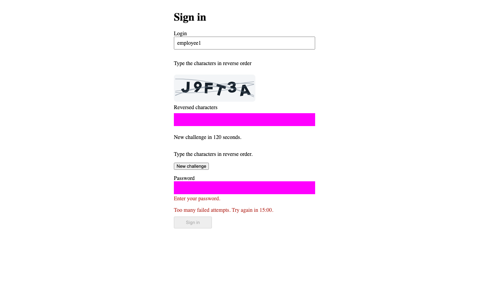
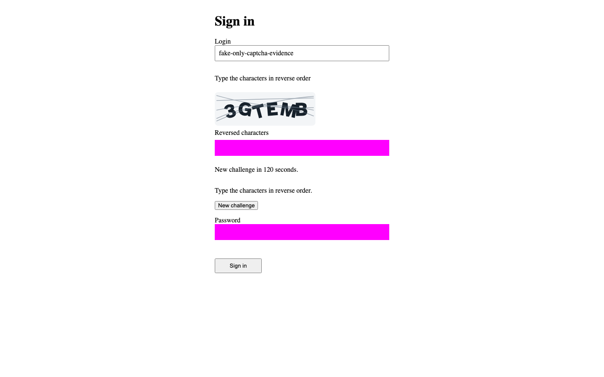
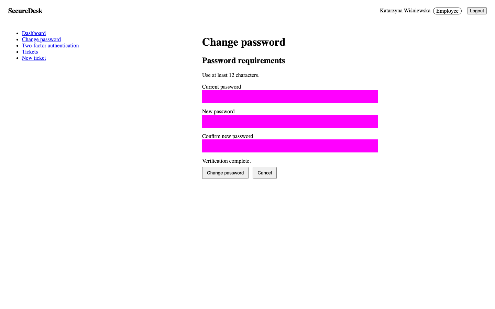
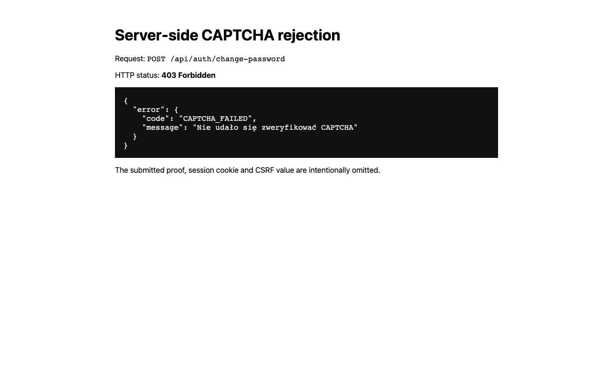
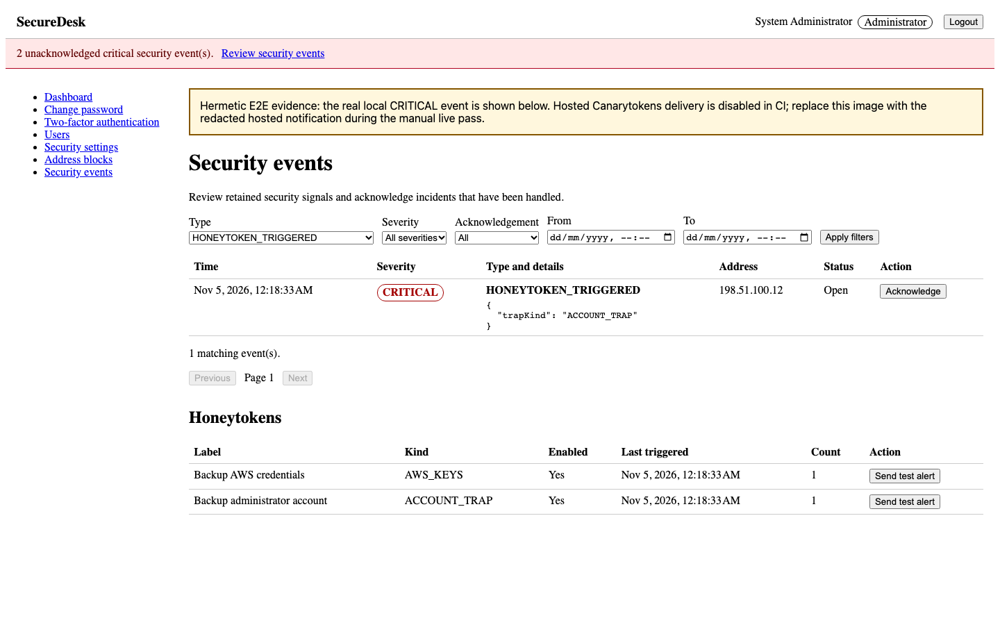
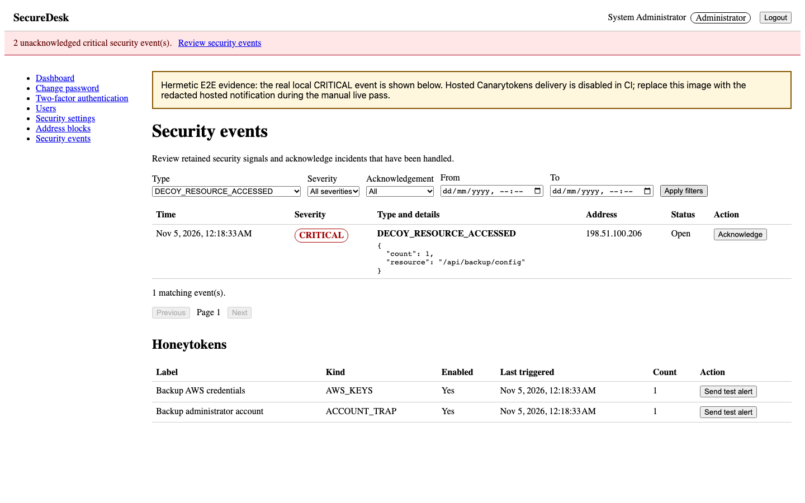
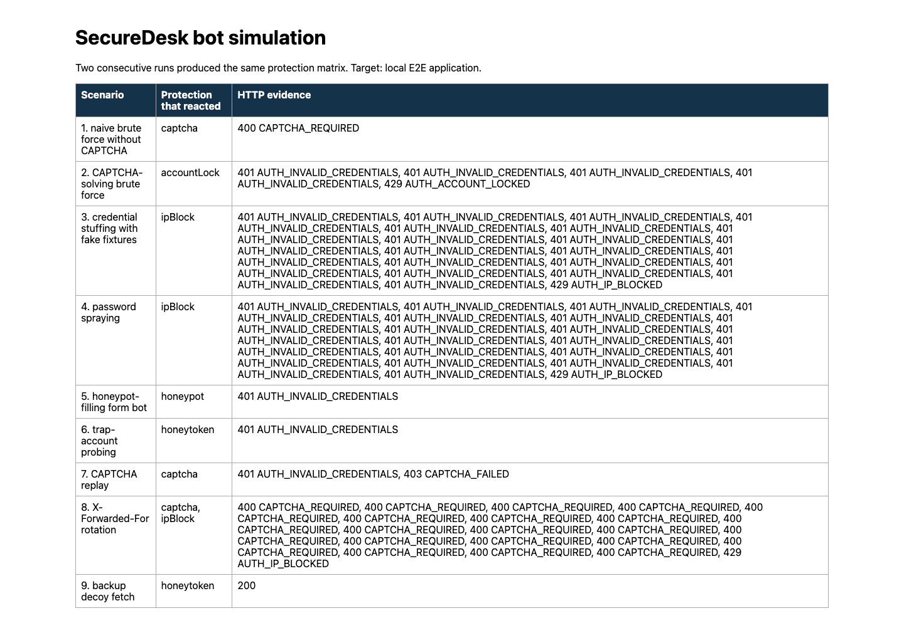
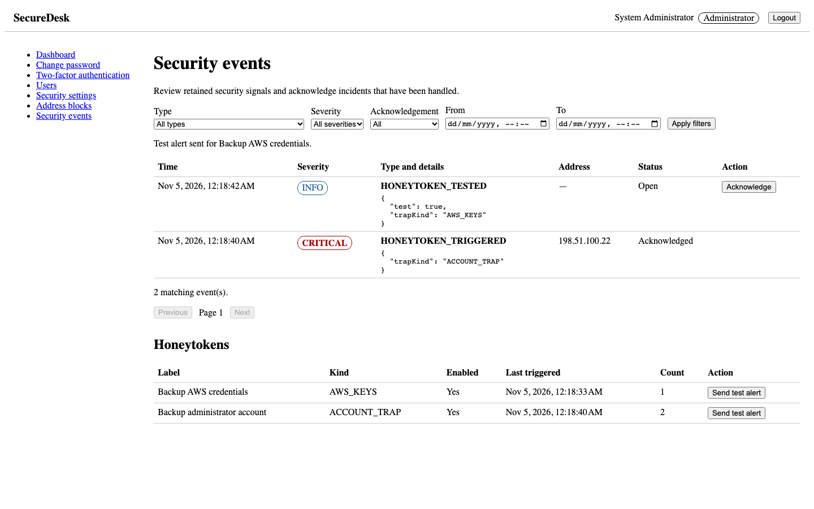

# SecureDesk

## Raport z realizacji modułu 2: ochrona przed botami i monitoring bezpieczeństwa

**Wariant:** 2  
**Autor:** Igor  
**Grupa i numer indeksu:** nie podano - uzupełnić przed oddaniem  
**Data opracowania:** 05.11.2026  
**Kod źródłowy:** https://github.com/IgorK834/SecureDesk

## Streszczenie

Moduł 2 rozszerza aplikację SecureDesk o warstwową ochronę logowania i zmiany hasła przed
automatyzacją. Zaimplementowano trwały licznik prób, blokadę konta i limit adresowy, dwa wymienne
mechanizmy CAPTCHA, pole-pułapkę, dwa honeytokeny, bezpieczne alerty, panel zdarzeń administratora
oraz kontrolowany symulator bota. Reguły są egzekwowane po stronie API. Interfejs jedynie prezentuje
stan i zbiera dowody, dlatego podrobienie odpowiedzi Angulara nie omija zabezpieczenia.

Login używa indywidualnego wariantu 2: użytkownik przepisuje sześć znaków w odwrotnej kolejności.
Zmiana hasła używa Cloudflare Turnstile, zaakceptowanego jako alternatywa dla reCAPTCHA. Token jest
weryfikowany przez serwer i wiązany z akcją, hostem oraz czasem wydania. Testy automatyczne nie
kontaktują się z Cloudflare, Canarytokens ani AWS: uruchamiają rzeczywiste aplikacje w przeglądarce,
ale podmieniają wyłącznie granice usług zewnętrznych. Trzy kolejne przebiegi pakietu Module 2 bez
ponowień zakończyły się wynikiem 7/7.

# 1. Wprowadzenie teoretyczne

## 1.1. Brute force, credential stuffing i password spraying

Atak brute force polega na wielokrotnym zgadywaniu hasła do jednego konta. Atakujący może używać
słownika, reguł modyfikacji lub pełnego przeglądu przestrzeni kandydatów. Ograniczenie liczby prób
dla loginu działa w tym przypadku bezpośrednio: po ustalonej liczbie porażek kolejne sprawdzenie
hasła nie jest wykonywane.

Credential stuffing wykorzystuje gotowe pary login-hasło wykradzione z innych usług. Każde konto
może otrzymać tylko jedną albo dwie próby, dlatego sam limit per konto jest za słaby. Ochrona musi
obserwować także adres źródłowy, wymagać dowodu obecności człowieka i nie ujawniać, które loginy
istnieją.

Password spraying odwraca proporcje: jedno popularne hasło jest sprawdzane na wielu kontach. Atak
celowo pozostaje poniżej progu pojedynczego loginu. SecureDesk łączy licznik per konto z licznikiem
per adres i zdarzeniem wykrywającym wiele różnych znormalizowanych loginów w krótkim oknie.

## 1.2. Obrona warstwowa

Nie istnieje pojedyncza kontrola zatrzymująca każdy rodzaj automatyzacji. CAPTCHA może zostać
rozwiązana przez człowieka lub usługę pośredniczącą. Limit per adres można omijać siecią proxy.
Blokadę konta można wykorzystać do odmowy usługi, a honeytoken wykrywa atak dopiero po dotknięciu
pułapki. Sens powstaje dopiero po połączeniu mechanizmów o różnych słabościach.

W SecureDesk kolejność logowania jest stała: honeypot, blokada adresu, CAPTCHA, honeytoken, blokada
konta, a na końcu weryfikacja poświadczenia. Każdy etap kończy żądanie przy odmowie. Dzięki temu
brak lub błędna CAPTCHA nie powoduje kosztownego haszowania i nie szkodzi licznikowi prawdziwego
konta, a wypełniona pułapka nie ujawnia botowi powodu odmowy.

## 1.3. CAPTCHA i jej ograniczenia

CAPTCHA nie dowodzi tożsamości. Ma jedynie podnieść koszt automatycznej próby. Własny obraz znaków
jest przewidywalny, podatny na OCR i nie korzysta z globalnej telemetrii. Jest przydatny jako
deterministyczne ćwiczenie pokazujące czas życia i jednorazowość, lecz nie powinien być jedyną
ochroną produkcyjną.

Obraz znaków ma również ograniczenie dostępności. Nie wolno wkładać odpowiedzi do tekstu
alternatywnego, bo zniszczyłoby to mechanizm. Potrzebna jest inna modalność. W projekcie alternatywą
jest gotowy provider Turnstile, a architektura pozwala przełączyć provider bez zmian w formularzu.
Provider zewnętrzny wprowadza jednak zależność dostępnościową, transfer danych, opóźnienie, nowe
źródła CSP, ryzyko zmian ceny i vendor lock-in.

## 1.4. Honeytokeny

Honeytoken jest przynętą, która nie ma legalnego zastosowania. Konto `backup_admin` nie ma rekordu
użytkownika, a dostęp do publicznej konfiguracji kopii zapasowej nie jest częścią normalnego
interfejsu. Użycie przynęty daje sygnał o bardzo wysokiej jakości, bo zwykły użytkownik nie powinien
jej dotknąć.

Projekt stosuje dwa typy. Pułapka konta zapisuje lokalne zdarzenie i opcjonalnie wywołuje Web bug.
Przynęta AWS udostępnia w kontrolowanym zasobie klucze utworzone przez usługę Canarytokens; dopiero
próba użycia ich wobec AWS generuje niezależne powiadomienie. Sekretne URL-e i wartości istnieją
wyłącznie w środowisku wdrożenia, nigdy w bazie konfiguracji, raporcie ani repozytorium.

# 2. Realizacja ćwiczenia

## 2.1. Wariant 2: odwrócony ciąg

Serwer losuje sześć znaków z alfabetu bez znaków łatwych do pomylenia. Oczekiwaną odpowiedzią jest
odwrócona kolejność. W bazie nie ma tekstu wyzwania ani odpowiedzi: przechowywany jest HMAC
identyfikatora i oczekiwanej wartości. SVG zawiera ścieżki glifów, przesunięcia, obroty i linie
szumu, ale nie element `text`.

Weryfikacja zaczyna się od atomowego oznaczenia rekordu jako zużytego, jeśli jeszcze nie został
użyty i nie wygasł. Dopiero potem następuje porównanie HMAC w stałym czasie. Błędna pierwsza
odpowiedź również spala wyzwanie. TTL wynosi 120 sekund. Tryb E2E akceptuje dodatkową odpowiedź
`TEST-SOLVED`, ale nadal wymaga wydanego, świeżego i jednorazowego identyfikatora; uruchomienie tego
trybu w produkcji kończy start błędem.

## 2.2. Liczenie prób i blokada

Próby są dopisywane do tabeli, a nie trzymane wyłącznie w pamięci. Transakcja `BEGIN IMMEDIATE`
rezerwuje próbę przed Argon2, dlatego równoległy burst nie przekracza skonfigurowanej liczby
weryfikacji. Domyślnie piąta zakończona porażka zamyka login na 15 minut. W czasie blokady hasło nie
jest sprawdzane, a poprawna wartość nie przesuwa końca blokady.

Blokada jest liczona również dla nieistniejącego loginu. To świadoma blokada fantomowa: użytkownik
i atakujący widzą taki sam kod, nagłówki i odliczanie niezależnie od istnienia konta. Osobny limit
adresowy zatrzymuje stuffing i spraying. Administrator może dopisać audytowany znacznik `CLEARED`,
który kończy poprzednie okno bez zmiany trwałego pola `users.is_blocked`.

## 2.3. Jedna umowa CAPTCHA

Backend wybiera provider z konfiguracji osobno dla celu `login` i `change-password`. Formularz
pobiera wyłącznie publiczne dane: identyfikator providera, klucz publiczny i akcję. Wspólny komponent
emituje obiekt CAPTCHA; formularz nie zna mechanizmu weryfikacji. Po każdej próbie, udanej lub nie,
komponent resetuje dowód.

Warstwa domenowa mapuje brak dowodu na `CAPTCHA_REQUIRED`, błąd na `CAPTCHA_FAILED`, a niedostępność
providera na `CAPTCHA_UNAVAILABLE`. Każda odmowa jest porażką adresową i zdarzeniem, ale nie porażką
konta. Produkcja odmawia startu przy brakującym sekrecie, testowym nadpisaniu URL lub opublikowanym
kluczu demonstracyjnym.

## 2.4. Weryfikacja Turnstile

Token z formularza jest danymi niezaufanymi. Adapter wysyła go metodą POST do `siteverify` razem z
sekretem po stronie serwera i rozpoznanym adresem klienta. Wywołanie ma trzysekundowy timeout i nie
jest automatycznie ponawiane w sposób, który mógłby podwójnie zużyć token. Token dłuższy niż 2048
znaków jest odrzucany przed siecią.

Samo `success=true` nie wystarcza. Odpowiedź musi mieć akcję zgodną z celem formularza, oczekiwany
hostname i `challenge_ts` nie starszy niż skonfigurowany limit. Replay, zła akcja, zły host i stary
token są odmową. Błąd sieci, timeout, kod 5xx albo błąd wewnętrzny providera daje 503 i blokuje
zmianę hasła przed sprawdzeniem bieżącego hasła oraz polityki. Jest to tryb fail-closed.

Turnstile wybrano zamiast literalnego Google reCAPTCHA, ponieważ wymagania dopuszczają tę
alternatywę, a student ją potwierdził. Adapter reCAPTCHA istnieje jako opcjonalny provider, ale nie
jest potrzebny do podstawowej demonstracji. Opcjonalny fallback do wewnętrznego wyzwania otwiera
się dopiero po pięciu kolejnych niedostępnościach i tylko przy jawnej fladze; bez niej zachowanie
pozostaje ściśle fail-closed.

## 2.5. Honeypot, honeytokeny i alerty

Pole `website` jest zwykłym polem tekstowym przesuniętym poza ekran. Ma `tabindex=-1`, jest wyłączone
z drzewa dostępności i nie używa `display:none`, więc prosty bot je widzi, a użytkownik klawiatury
nie. Niepusta wartość uruchamia jedno haszowanie atrapowe, porażkę adresową i zagregowane zdarzenie,
ale nie dotyka CAPTCHA ani licznika konta. Odpowiedź jest bajtowo zgodna z błędnym hasłem.

Honeytoken `account-trap-backup-admin` rezerwuje login bez tworzenia użytkownika. Po CAPTCHA
wywołuje wspólną usługę alertową, a potem przechodzi normalną ścieżką nieznanego loginu. Honeytoken
`decoy-aws-keys` jest związany z publicznym `GET /api/backup/config`, reklamowanym w `robots.txt`.
Endpoint zawsze działa, nawet bez kluczy, i zwraca wtedy niesekretne placeholdery.

Każde trafienie zapisuje zdarzenie. Zewnętrzne powiadomienie jest deduplikowane dla tokenu i adresu
przez pięć minut, działa w tle, ma timeout i co najwyżej jedno ponowienie. Awaria kanału ustawia
status `FAILED`, ale nie opóźnia ani nie psuje żądania atakującego. Wychodzące dane ograniczono do
identyfikatora zdarzenia i statycznej etykiety. Login, hasło, IP i nagłówki atakującego nie opuszczają
aplikacji.

## 2.6. Widoczność dla administratora

Tylko Administrator ma uprawnienia do listy zdarzeń, potwierdzania zdarzeń, odblokowania loginu,
blokad adresowych i panelu honeytokenów. API stosuje ścisłe query, jawny mapper DTO i rekurencyjny
zakaz kluczy przypominających hasło, token, sekret lub odpowiedź CAPTCHA. Potwierdzenie jest
idempotentne i nie zmienia szczegółów zdarzenia.

Baner krytycznych zdarzeń jest pobierany raz po zakończonej nawigacji, nie w pętli. Dzięki temu nie
podtrzymuje sesji bezczynnego administratora. Retencja zdarzeń jest konfigurowalna, a niepotwierdzony
incydent krytyczny może żyć dłużej niż zwykły wpis.

## 2.7. Wybrane fragmenty kodu

Poniższe skróty pokazują granice bezpieczeństwa, bez danych uwierzytelniających.

### Kontrakt providera

```typescript
export interface CaptchaProvider {
  readonly id: 'turnstile' | 'internal' | 'recaptcha';
  publicConfig(purpose: CaptchaPurpose): CaptchaPublicConfig;
  verify(input: unknown, ctx: CaptchaContext): Promise<CaptchaResult>;
}
```

### Jednorazowe zużycie wyzwania

```sql
UPDATE captcha_challenges
SET consumed_at = ?
WHERE id = ?
  AND consumed_at IS NULL
  AND expires_at > ?
```

### Kolejność logowania

```text
honeypot -> IP block -> CAPTCHA -> honeytoken
          -> account lock -> credential verification
```

### Minimalny alert własny

```json
{
  "type": "HONEYTOKEN_TRIGGERED",
  "time": "<UTC timestamp>",
  "severity": "CRITICAL",
  "eventId": "<generated id>"
}
```

## 2.8. Decyzje, odstępstwa i ograniczenia

- Turnstile zastępuje reCAPTCHA zgodnie z dopuszczoną alternatywą; formularze pozostają niezależne
  od providera.
- Nieistniejące loginy dostają blokady fantomowe, aby countdown nie stał się wyrocznią istnienia
  konta.
- Limit adresowy ogranicza spraying, lecz może czasowo dotknąć wielu użytkowników za NAT-em.
- Awaria Turnstile domyślnie blokuje zmianę hasła. Jest to świadomy wybór fail-closed.
- Własna CAPTCHA demonstruje wariant i lifecycle, lecz jest słaba wobec OCR i wymaga dostępnej
  alternatywy.
- Circuit breaker i limitery publicznych endpointów są procesowe; wdrożenie wieloinstancyjne
  wymaga wspólnego atomowego magazynu.
- Automatyczne dowody Canarytokens pokazują prawdziwe lokalne zdarzenia, nie zmyślone e-maile.
  Dwa pliki z żółtą adnotacją należy zastąpić redagowanymi powiadomieniami po ręcznym wdrożeniu.

# 3. Dowody wykonania

## 3.1. Blokada konta i odliczanie

Po piątej porażce formularz pokazuje pozostałe 15 minut i blokuje przycisk. Wyzwanie i odpowiedź są
odświeżane, a hasło oraz odpowiedź CAPTCHA zostały zamaskowane przez Playwright. Dalsza część testu
loguje administratora, odblokowuje konto i potwierdza poprawne logowanie użytkownika.



## 3.2. CAPTCHA wariantu 2 przy logowaniu

Widoczny jest rzeczywiście wygenerowany obraz z glifami oraz instrukcja odwrócenia kolejności.
Dowód E2E używa testowej odpowiedzi tylko w zamaskowanym polu. Po wysłaniu błędnego hasła test
sprawdza, że następna próba ma inny identyfikator i obraz.



## 3.3. Turnstile przy zmianie hasła

Skrypt widgetu oraz endpoint weryfikacji są lokalnymi stubami o tym samym kontrakcie. Pozwala to
pokazać stan `Verification complete` w prawdziwym formularzu bez zależności od dostępności
Cloudflare. Wszystkie trzy pola haseł są zamaskowane.



## 3.4. Podrobiony token odrzucony przez API

Test wysyła podrobiony proof bezpośrednio do prawdziwego endpointu. Zrzut jest zbudowany z
rzeczywistej, zsanityzowanej odpowiedzi: HTTP 403 i `CAPTCHA_FAILED`. Nie pokazuje proofu, cookie ani
wartości CSRF. Jest to dowód serwerowej kontroli, a nie komunikat UI.



## 3.5. Pułapka konta

Hermetyczny przebieg pokazuje lokalne krytyczne zdarzenie po próbie `backup_admin`, jego typ i panel
statusu honeytokenów. Żółta adnotacja świadomie informuje, że zewnętrzna dostawa jest wyłączona w CI.
Przed oddaniem ten plik powinien zostać zastąpiony zredagowaną wiadomością Web bug zgodnie z
runbookiem; nie wolno produkować fikcyjnego e-maila.



## 3.6. Przynęta AWS

Pobranie `/api/backup/config` tworzy rzeczywiste zagregowane zdarzenie krytyczne i zwiększa licznik
drugiego honeytokenu. Powiadomienie dostawcy powstaje dopiero po ręcznym użyciu kontrolowanych
kluczy wobec AWS i może dotrzeć z opóźnieniem. Zrzut ma tę samą jawną adnotację o konieczności
zastąpienia go redagowanym e-mailem z live pass.



## 3.7. Symulacja bota

Skrypt wykonał dziewięć kontrolowanych scenariuszy na lokalnej aplikacji: brute force bez CAPTCHA,
brute force z rozwiązaniem, stuffing, spraying, honeypot, konto-pułapkę, replay CAPTCHA, obrót
nagłówka adresowego i pobranie decoya. Każdy scenariusz ma warstwę zatrzymującą oraz dowód HTTP.
Dwa kolejne uruchomienia wewnątrz specyfikacji dały taką samą macierz.



## 3.8. Zdarzenia bezpieczeństwa

Widok administratora pokazuje test alertu, zdarzenie krytyczne, potwierdzenie i panel obu
honeytokenów. Test osobno potwierdza 401 dla anonimowego i 403 dla pozostałych ról oraz brak URL-i i
kluczy w DTO.



# 4. Odpowiedzi na pytania kontrolne

## 4.1. Dlaczego własna ochrona przed botami jest trudniejsza od gotowego rozwiązania?

Własna aplikacja widzi tylko niewielki wycinek ruchu i nie ma globalnych danych o urządzeniach,
reputacji sieci, wzorcach zachowania ani aktualnych kampaniach. Atakujący rozwijają OCR, modele AI i
usługi rozwiązywania, więc własne zadanie szybko się starzeje, a utrzymanie i bezpieczeństwo samego
mechanizmu stają się obowiązkiem autora. Gotowy provider ma większy zbiór sygnałów i zespół, który
go aktualizuje, lecz nie jest darmowym zyskiem: tworzy zależność dostępnościową i vendor lock-in,
może zmienić cenę, dodaje opóźnienie i powierzchnię CSP, przekazuje dane stronie trzeciej oraz może
rodzić obowiązki prywatności i GDPR. Dlatego SecureDesk zachowuje wspólny kontrakt, sprawdza token
na serwerze i jawnie wybiera między fail-closed a ograniczonym fallbackiem.

## 4.2. Czym różni się credential stuffing od password spraying?

Credential stuffing odtwarza pary login-hasło wykradzione z innych usług i wykorzystuje ponowne
użycie haseł. Atak może wykonać tylko jedną próbę dla każdego konta, ale każda para ma inne hasło.
Password spraying sprawdza jedno lub kilka popularnych haseł na wielu kontach i celowo pozostaje
poniżej limitów per konto. Z tego powodu klasyczna blokada loginu dobrze tłumi brute force, ale nie
wystarcza na spraying. Potrzebne są limity per adres lub urządzenie, obserwacja liczby różnych
loginów, CAPTCHA oraz alerty. SecureDesk symuluje oba przypadki na wyraźnie fikcyjnych danych.

## 4.3. Jakie niebezpieczeństwo wprowadza blokada konta?

Blokada może stać się narzędziem odmowy usługi: atakujący świadomie wykonuje N błędnych prób wobec
wybranych pracowników lub jedynego administratora. Rozróżnienie komunikatu dla istniejącego konta
tworzyłoby dodatkowo enumerację. Ograniczenia zastosowane w projekcie to CAPTCHA przed liczeniem
konta, osobny limit adresowy, krótka 15-minutowa blokada, audytowana procedura odblokowania,
zdarzenie dla administratora i identyczne blokady fantomowe dla nieistniejących loginów. Nie usuwa
to ryzyka całkowicie, dlatego próg i sygnały trzeba monitorować, a mechanizmu nie należy traktować
jako jedynej ochrony.

## 4.4. Dlaczego honeytoken ma mało fałszywych alarmów?

Honeytoken jest projektowany tak, aby nie używał go żaden legalny użytkownik, proces ani dokument.
Dotknięcie konta-pułapki albo użycie kontrolowanych kluczy jest więc z definicji odstępstwem od
normalnej pracy i nie wymaga uczenia skomplikowanej linii bazowej. Fałszywy alarm nadal może powstać,
jeśli wewnętrzny skaner, backup, indeksator lub tester czyta wszystkie zasoby. Dlatego decoye muszą
być wyłączone z legalnych zadań masowych, test alertu jest oznaczony, a zewnętrzne powiadomienia są
deduplikowane. Każde trafienie pozostaje w lokalnym audycie nawet wtedy, gdy dostawa alertu zostanie
stłumiona.

# 5. Testy i wyniki

Testy jednostkowe, komponentowe i integracyjne utrzymują wspólny próg co najmniej 80 procent dla
linii, instrukcji, funkcji i gałęzi. Identyfikatory SEC-31 do SEC-62 są mapowane do tytułów testów.
Granice czasowe korzystają z fake clock; żaden test nie śpi w czasie rzeczywistym ani nie otwiera
bazy developerskiej. Testy mutacyjne potwierdzają, że zmiana `>=` na `>`, usunięcie etapu CAPTCHA i
uwrażliwienie porównania honeypotu na wielkość liter powodują porażkę.

Pakiet browser Module 2 działa z jednym workerem i bez retry. W dniu 05.11.2026 trzy następujące po
sobie uruchomienia zakończyły się identycznie: 7/7, 7/7 i 7/7. Każdy przebieg odtwarza izolowaną bazę
E2E i osiem obrazów. Test Turnstile sprawdza zarówno gotowy widget, jak i bezpośrednią odmowę API;
test honeytokenów sprawdza lokalny efekt bez zależności od usługi hosted.

# 6. Wnioski

Cel techniczny został osiągnięty: każdy login i obie zmiany hasła wymagają świeżego, serwerowo
zweryfikowanego dowodu; równoległe próby nie omijają progu; boty mają pułapkę; dwa różne honeytokeny
trafiają do wspólnej, bezpiecznej ścieżki zdarzeń; administrator może obserwować i potwierdzać
incydenty; symulator pokazuje, która warstwa reaguje.

Najważniejszym wnioskiem jest brak absolutnej ochrony. Własna CAPTCHA nie jest rozwiązaniem
produkcyjnym, provider może mieć awarię, adres IP nie jest tożsamością, blokadę można wykorzystać do
DoS, a honeytoken działa dopiero po kontakcie z przynętą. Ochrona jest użyteczna dzięki warstwom,
jawnej kolejności, trwałemu audytowi, zachowaniu fail-closed i testom negatywnym.

Przed ostatecznym oddaniem pozostają dwie czynności operatorskie, których repozytorium nie może
wykonać bez danych właściciela: wpisać grupę i numer indeksu oraz zastąpić dwa żółte dowody
Canarytokens zredagowanymi wiadomościami po ręcznym live pass. Sekretów nie wolno wstawiać do
raportu nawet na chwilę.

# 7. Repozytorium i reprodukcja

Kod źródłowy: https://github.com/IgorK834/SecureDesk

Instrukcja uruchomienia i demonstracji znajduje się w `README.md`. Procedura prawdziwych tokenów i
redakcji dowodów znajduje się w `docs/canarytokens.md`. Mapa scenariuszy i obrazów znajduje się w
`docs/report-evidence/module-2/README.md`, a pełne śledzenie testów w `docs/testing.md`.

# 8. Źródła

- Cloudflare Turnstile, dokumentacja testowania i weryfikacji po stronie serwera:
  https://developers.cloudflare.com/turnstile/
- OWASP, Automated Threats to Web Applications:
  https://owasp.org/www-project-automated-threats-to-web-applications/
- OWASP, Authentication Cheat Sheet:
  https://cheatsheetseries.owasp.org/cheatsheets/Authentication_Cheat_Sheet.html
- Canarytokens, dokumentacja Web bug i AWS keys opisana bez sekretnego URL w lokalnym runbooku.
- Dokumentacja i testy projektu SecureDesk w repozytorium wskazanym powyżej.
