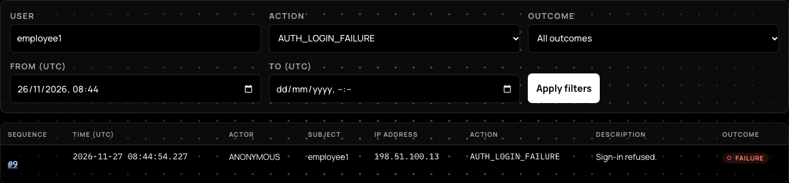
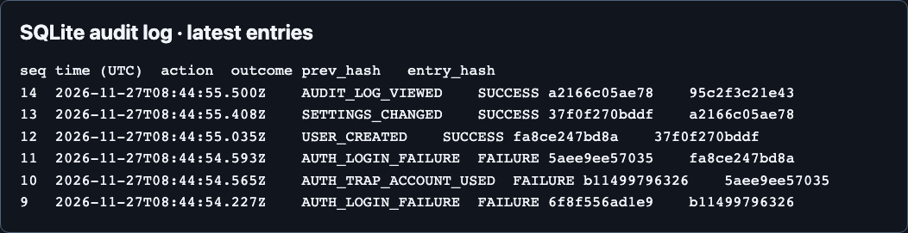
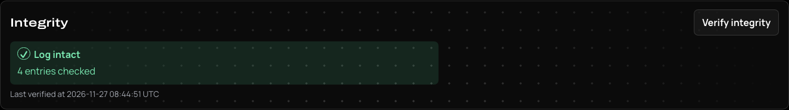
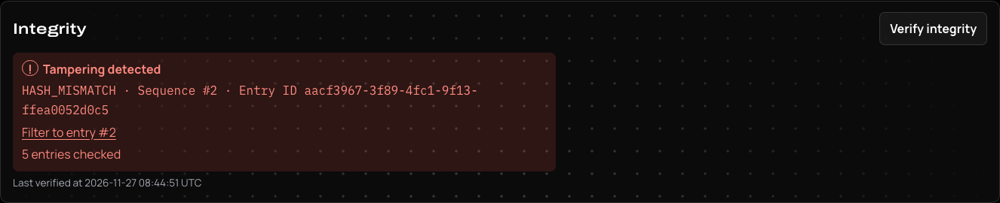
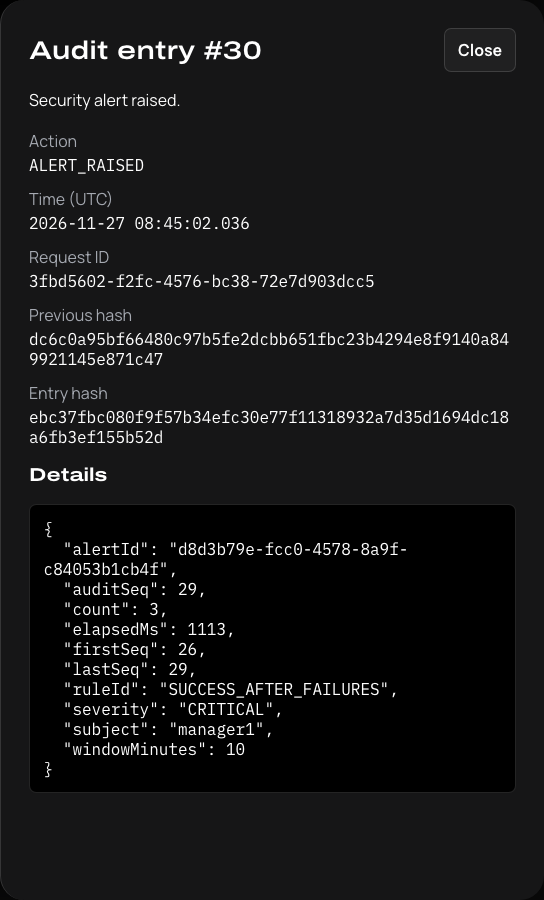
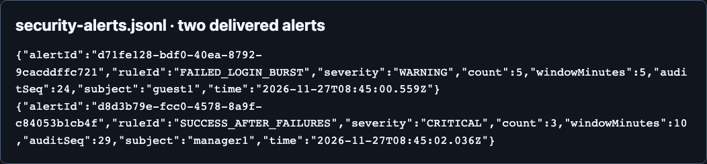
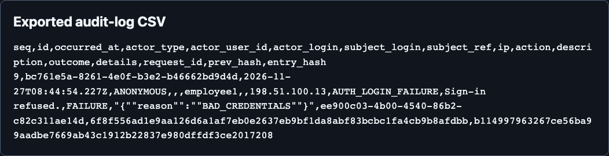
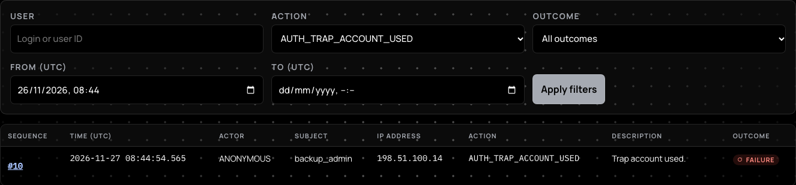

# SecureDesk

## Raport z realizacji modułu 3

## Streszczenie

SecureDesk zapisuje działania istotne dla bezpieczeństwa w tabeli audytowej SQLite. Raport
przedstawia wariant 2, w którym wpisy łączy łańcuch SHA-256, a alerty trafiają do osobnego pliku.
Administrator może odczytać, wyeksportować i zweryfikować historię oraz powiązać alert z
konkretnymi wpisami. Dowody pochodzą z rzeczywistych przebiegów testowej aplikacji. Testy używały
tymczasowych baz i lokalnych atrap usług zewnętrznych.

# 1. Wprowadzenie teoretyczne

Dziennik pozwala ustalić, jakie działania doprowadziły do incydentu i kto na niego zareagował.
Przydatny wpis ma stały typ, jednoznaczny wynik, czas w UTC, identyfikator żądania oraz możliwe
do ustalenia dane aktora i podmiotu. Oddzielenie pól od opisu ułatwia analizę pod kątem reguł
oraz filtrowanie niezależnie od strefy czasowej administratora. Dane wejściowe mogą zawierać
znaki zmieniające strukturę lub wygląd tekstu, dlatego trzeba je znormalizować przed zapisem
i bezpiecznie wyświetlić podczas analizy.

Zdarzenie operacyjne może podlegać agregacji, potwierdzeniu i retencji. Historia audytowa ma inne
zadanie. Powinna zachować chronologię działań i umożliwić wykrycie zmian w przeszłości. Łańcuch
skrótów upraszcza kontrolę spójności, a niezależny punkt odniesienia pozwala sprawdzić także
kompletność końca historii. Narzędzie klasy SIEM zbiera zdarzenia z wielu źródeł, koreluje je
i kieruje alarmy do obsługi incydentów. Projekt pokazuje ten przepływ w ograniczonej skali.

# 2. Realizacja wariantu 2

## 2.1. Cztery elementy wariantu

- Dziennik jest tabelą `audit_log` w bazie aplikacji, oddzieloną od tabeli `security_events`.
- Integralność wpisów sprawdza łańcuch SHA-256 z polami `prev_hash` i `entry_hash`.
- Reguła wariantu zgłasza udane logowanie po co najmniej trzech błędnych hasłach na to samo konto.
- Alerty trafiają do odrębnego pliku `security-alerts.jsonl` oraz do panelu zdarzeń.

## 2.2. Przykład wpisu

Poniżej znajduje się wiersz z eksportu JSON Lines wykonanego w przeglądarce na danych testowych.
Adres pochodzi z zakresu dokumentacyjnego. Skróty dotyczą wpisów audytowych.

```json
{
  "seq": 9,
  "id": "bc761e5a-8261-4e0f-b3e2-b46662bd9d4d",
  "occurred_at": "2026-11-27T08:44:54.227Z",
  "actor_type": "ANONYMOUS",
  "actor_user_id": null,
  "actor_login": null,
  "subject_login": "employee1",
  "subject_ref": null,
  "ip": "198.51.100.13",
  "action": "AUTH_LOGIN_FAILURE",
  "description": "Sign-in refused.",
  "outcome": "FAILURE",
  "details": "{\"reason\":\"BAD_CREDENTIALS\"}",
  "request_id": "ee900c03-4b00-4540-86b2-c82c311ae14d",
  "prev_hash": "6f8f556ad1e9aa126d6a1af7eb0e2637eb9bf1da8abf83bcbc1fa4cb9b8afdbb",
  "entry_hash": "b114997963267ce56ba99aadbe7669ab43c1912b22837e980dffdf3ce2017208"
}
```

## 2.3. Katalog zdarzeń

| Obszar                               | Zdarzenia                                                                                                                                           |
| ------------------------------------ | --------------------------------------------------------------------------------------------------------------------------------------------------- |
| Logowanie i sesje                    | `AUTH_LOGIN_SUCCESS`, `AUTH_LOGIN_FAILURE`, `AUTH_LOGOUT`, `AUTH_SESSION_EXPIRED`, `AUTH_ACCOUNT_LOCKED`, `AUTH_TRAP_ACCOUNT_USED`                  |
| Hasła i drugi składnik               | `PASSWORD_CHANGED`, `PASSWORD_CHANGE_FAILED`, `PASSWORD_RESET_BY_ADMIN`, `AUTH_TOTP_CHALLENGE`, `TOTP_ENROLLED`, `TOTP_DISABLED`, `USER_TOTP_RESET` |
| Administracja kontami i ustawieniami | `USER_CREATED`, `USER_UPDATED`, `USER_ROLE_CHANGED`, `USER_BLOCKED`, `USER_UNBLOCKED`, `USER_DELETED`, `USER_UNLOCKED`, `SETTINGS_CHANGED`          |
| Dostęp, przynęty i start systemu     | `ACCESS_DENIED`, `OBJECT_ACCESS_DENIED`, `DECOY_RESOURCE_ACCESSED`, `HONEYTOKEN_ALERT_RECEIVED`, `DATABASE_SEEDED`, `RETENTION_PURGED`              |
| Obsługa audytu i alarmy              | `AUDIT_LOG_VIEWED`, `AUDIT_LOG_EXPORTED`, `AUDIT_LOG_VERIFIED`, `ALERT_RAISED`, `AUDIT_TAMPER_DETECTED`                                             |

## 2.4. Zapis i weryfikacja

Operacje modyfikujące stan i udane logowania zapisują działanie i audyt w tej samej transakcji.
Brak zapisu powoduje wycofanie operacji. Odmowa dostępu pozostaje odmową nawet wtedy, gdy zapis
się nie powiedzie, a błąd trafia do logu operacyjnego. SQLite odrzuca `UPDATE`, `DELETE` i nadpisanie
istniejącego wiersza przez `REPLACE`. Wpisy nie podlegają zadaniu retencji.

Pierwszy poprzedni skrót to 64 zera. System oblicza
`SHA-256(prev_hash + LF + canonical(entry))` z kodowaniem UTF-8. Kanoniczny JSON zawiera
wersję formatu i pola w ustalonej kolejności. Klucze szczegółów są sortowane przed zapisem.
Poniższe fragmenty pokazują budowę wpisu i warunki weryfikacji
(`server/audit/append.ts`, `chain.ts`, `verify.ts`).

```typescript
const prevHash = head?.entryHash ?? GENESIS_HASH;
const row = {
  ...content,
  prevHash,
  entryHash: computeEntryHash(prevHash, canonicalize(content)),
};
tx.insert(auditLog).values(row).run();
markAuditAppended(tx, row);
```

```typescript
if (row.seq !== previousSeq + 1) return 'SEQUENCE_GAP';
if (row.prevHash !== previousHash) return previousSeq === 0 ? 'GENESIS_MISMATCH' : 'CHAIN_BROKEN';
if (computeEntryHash(row.prevHash, canonicalize(row)) !== row.entryHash) return 'HASH_MISMATCH';
```

Weryfikator skanuje wpisy według numeru sekwencji, wykrywa także nieprawidłowy format skrótu
i wskazuje pierwszą rozbieżność. Po zatwierdzeniu transakcji aplikacja aktualizuje prywatny
plik kotwicy, zawierający numer sekwencji i skrót ostatniego zapamiętanego wpisu. Kotwica
może być starsza od bieżącego końca, jeśli jej wpis nadal się zgadza. Brak pliku jest
ostrzeżeniem. Niezgodność kotwicy sygnalizuje `HEAD_MISMATCH`. Administrator uruchamia
kontrolę z panelu, a aplikacja uruchamia ją także po zapisach, domyślnie najwyżej raz na
godzinę. Powtarzające się to samo wykrycie nie wysyła kolejnego alarmu.

## 2.5. Reguły i kanały alertów

Pierwsza reguła zgłasza `WARNING`, gdy dla jednego podmiotu wystąpiło co najmniej pięć
błędnych haseł lub odmów z powodu blokady w ostatnich pięciu minutach. Drugą regułę
uruchamia sukces po co najmniej trzech błędnych hasłach do tego samego konta w ostatnich
dziesięciu minutach. Poprzedni sukces zamyka serię, a odmowa CAPTCHA nie zwiększa licznika.
Reguła druga zgłasza `CRITICAL`. Pięciominutowa przerwa między alertami dotyczy pary
reguła i podmiot i przetrwa ponowne uruchomienie procesu.

Poniżej warunek reguły wariantu po zliczeniu nieudanych prób
(`server/detection/rules/success-after-failures.ts`).

```typescript
return result.count >= threshold
  ? {
      count: result.count,
      firstSeq: result.firstSeq!,
      lastSeq: entry.seq,
      elapsedMs: now.getTime() - Date.parse(result.earliest!),
    }
  : null;
```

Alert jest zapisywany w audycie i w zdarzeniach bezpieczeństwa w jednej transakcji. Dostawa
następuje po zatwierdzeniu. Plik ma tryb `0600`, a katalog `0700`. Wspólny identyfikator
umożliwia porównanie trzech zapisów. Błąd kanału ustawia status `FAILED` przy zdarzeniu,
zachowując dowód w bazie. Fragment dispatchera pokazuje ochronę pliku przed podstawieniem
dowiązania oraz tryb dopisywania (`server/alerts/file-alert-dispatcher.ts`).

```typescript
const file = await open(
  filename,
  constants.O_WRONLY | constants.O_CREAT | constants.O_APPEND | constants.O_NOFOLLOW,
  0o600,
);
try {
  // Pełna implementacja sprawdza typ, prawa i liczbę dowiązań.
  await file.appendFile(line);
} finally {
  await file.close();
}
```

Odebrane powiadomienia Canarytokens są walidowane i zapisywane bez danych zaplecza
dostawcy. Aplikacja wygasza powtórzenia i zatrzymuje dalszą wysyłkę, aby przerwać pętlę
powiadomień. Opcjonalny Loki otrzymuje wiersze według sekwencji, z pełnymi skrótami.
W testach użyto lokalnych atrap, w tym awarii i późniejszej dostępności kolektora.
Sprawdzono konfigurację Compose, źródło danych i zapytania panelu. Nie uruchamiano
rzeczywistego zewnętrznego kolektora ani dostawcy powiadomień.

## 2.6. Decyzje i odstępstwa

Wariant zachowuje cztery role. Nie dodano roli audytora, a odczyt, eksport i weryfikacja
mają osobne uprawnienia administratora. Przyjęto dziesięciominutowe okno reguły drugiej
dla określenia „zaraz po”. Reguła pierwsza zalicza odmowy po blokadzie, dzięki czemu
niski próg blokady nie zasłania serii. Nieznane loginy są reprezentowane referencją
obliczoną z HMAC. Audyt zapisuje odmowy uwierzytelnionych użytkowników i odmowy na poziomie
obiektu. Anonimowe odpowiedzi `401` nie tworzą osobnego wpisu każda. Interfejs jest po
angielsku, a komunikaty API utrzymano po polsku.

Historia audytu rośnie bez automatycznego usuwania. Agregacja i wygaszanie dotyczą
operacyjnej tabeli zdarzeń. W pokazie integralności użyto kopii oraz osobnych syntetycznych
historii do oceny roli kotwicy. Weryfikację przeglądarkową wykonano na testowym wierszu
z przywróceniem oryginału. Oba zadania dodatkowe zaimplementowano, a ich dowody dotyczą
testów lokalnych z atrapami.

# 3. Dowody wykonania

## 3.1. Filtrowanie dziennika

Filtry zawężają wynik do nieudanego logowania testowego pracownika, okresu w UTC
i typu zdarzenia. Tabela pokazuje wynik, czas, aktora i podmiot.



## 3.2. Zapis w SQLite

Fragment rzeczywistego wyjścia narzędzia `show-audit-table.sh` pokazuje numery sekwencji,
akcje, wyniki i pierwsze 12 znaków obu skrótów. Widać także zmiany zainicjowane przez
administratora.



## 3.3. Integralna historia

Weryfikację uruchomiono klawiaturą. Panel zgłosił „Log intact” wraz z liczbą sprawdzonych
wpisów i czasem zakończenia w UTC.



## 3.4. Wykrycie zmiany

Po zmianie opisu w testowej bazie panel wskazał numer sekwencji, identyfikator i
`HASH_MISMATCH`. Łącze zawęziło tabelę do wskazanego wpisu. Test przywrócił treść i
wyzwalacz oraz ponownie uzyskał wynik `INTACT`.



## 3.5. Alert w akcie audytu

Szczegóły `ALERT_RAISED` wiążą alarm krytyczny z regułą, liczbą nieudanych prób
i zakresem sekwencji. Identyfikator w panelu jest taki sam jak w wierszu pliku z
rysunku 6.



## 3.6. Osobny plik alertów

Dwie rzeczywiste linie pliku odpowiadają obu regułom. Wspólny identyfikator alertu
krytycznego porównano automatycznie z tym pokazanym w przeglądarce.



## 3.7. Eksport dowodu

CSV pobrano z aktywnymi filtrami. Zawiera pola zdarzenia oraz oba skróty. Test
odczytał też zapis eksportu w aplikacji i sprawdził liczbę wybranych wierszy.



## 3.8. Pułapka konta

Nieudane logowanie na testową nazwę pułapki wygenerowało `AUTH_TRAP_ACCOUNT_USED`.
Dziennik zachował typ zdarzenia i podmiot, a klient otrzymał zwykłą odpowiedź
nieudanego logowania.



# 4. Odpowiedzi na pytania kontrolne

## 4.1. Dlaczego warto korzystać z gotowych narzędzi?

Budowa niezawodnego dziennika to także obsługa formatów, wyszukiwania, retencji, rotacji,
awarii i alarmów oraz weryfikowanie reguł w zmieniającym się środowisku. Gotowe biblioteki
i systemy SIEM mają udokumentowane integracje, zasady eksploatacji oraz doświadczenie
operatorów. Własny mechanizm ma tu cel dydaktyczny, ponieważ pozwala prześledzić każdy
etap od żądania do niezależnego sprawdzenia skrótu. Przy wdrożeniu rozproszonym warto
oprzeć transport i korelację na utrzymywanych narzędziach i jawnych zasadach dostępu.

## 4.2. Dlaczego zakaz obejmuje także błędne hasła?

Błędne hasło często różni się od prawdziwego jednym znakiem lub jest poprawne w innej
usłudze. Dzienniki czyta więcej osób, bywają kopiowane do narzędzi analitycznych i mogą
mieć dłuższą retencję niż właściwy magazyn poświadczeń. Użytkownik może również wkleić
hasło w pole loginu. Zamknięty katalog szczegółów, stałe opisy i referencje HMAC dla
nieznanych loginów zmniejszają zakres danych, które trafią do kopii.

## 4.3. Na czym polega log injection?

Jeśli aplikacja bezpośrednio zapisuje ciąg kontrolowany przez użytkownika, znaki końca
wiersza mogą rozbić wpis i upozorować kolejne zdarzenie. Znaki sterujące kierunkiem pisma
mogą zmienić sposób odczytania danych, a treść zaczynająca się od formuły może być groźna
podczas eksportu do arkusza. Strukturalny zapis, neutralizacja znaków sterujących,
stałe szablony opisu, ucieczka formuł CSV i tekstowe renderowanie w Angularze chronią
zarówno parser, jak i osobę analizującą historię.

## 4.4. Co wykrywa łańcuch i gdzie jest jego granica?

Wpis wiąże treść z poprzednim skrótem, więc zmiana treści daje inny wynik obliczenia,
a usunięcie w środku rozrywa sekwencję i ciąg odwołań. Poprawny przedrostek samodzielnie nie
dowodzi zachowania końca historii. Osoba kontrolująca pliki może podmienić lokalną historię
i jej punkt odniesienia. Kotwica wykrywa rozbieżność z zapamiętanym stanem, a kopia poza
hostem zwiększa szansę zachowania stanu pierwotnego przy kompromitacji maszyny. HMAC
z kluczem przechowywanym osobno albo magazyn jednokrotnego zapisu rozszerza ochronę.
MD5 i SHA-1 mają praktyczne ataki kolizyjne, dlatego użyto SHA-256.

# 5. Wnioski z modułów 1-3

Moduł 1 wprowadził Argon2id, ograniczone sesje i uprawnienia ról oraz bezpieczne cykle
zmian haseł. Moduł 2 ogranicza automatyczne nadużycia przez CAPTCHA, blokady kont
i adresów oraz pułapki. Moduł 3 zachowuje dowód podjętej decyzji i pozwala powiązać
alert z działaniem oraz reakcją administratora. Test przeglądarkowy przeszedł od prób
logowania przez alarm i potwierdzenie zdarzenia do resetu hasła i blokady konta.
Takie warstwy służą kolejno ograniczaniu dostępu, wykrywaniu prób i odtworzeniu
przebiegu incydentu.

SQLite jest używana w architekturze jednego procesu aplikacji. Część limiterów
działa w pamięci i po restarcie traci stan. Audyt jest odporny na niezauważoną lokalną
zmianę w granicach posiadanych dowodów, a administrator hosta nadal może nadpisać pliki.
Bezwzględna retencja spełnia warunki ćwiczenia, lecz adresy IP i loginy są danymi
osobowymi. Przed wdrożeniem należałoby uzasadnić czas przechowywania, ograniczyć
dostęp, zaprojektować archiwizację i ustalić sposób realizacji obowiązków prywatności.
Dalsze prace obejmują niezależną kopię, kontrolę kluczy i współdzielony limiter
dla większej liczby instancji.

Weryfikacja objęła 2 834 testy i pokrycie 97,43% instrukcji, 92,31% gałęzi,
98,68% funkcji i 98,59% linii. Pięć mutacji dało oczekiwane niepowodzenie,
a cztery testy przeglądarkowe przeszły trzy kolejne przebiegi bez ponowień. Wszystkie przebiegi używały baz tymczasowych,
a integracje zewnętrzne były wyłączone lub zastąpione lokalnymi atrapami.

# Repozytorium i reprodukcja

Repozytorium https://github.com/IgorK834/SecureDesk zawiera kod,
instrukcję odtworzenia w README oraz raporty poprzednich modułów. Polecenie
`npm run test:e2e:module3 -- --evidence` odtwarza dowody, a `npm test` sprawdza
mapowanie SEC i pokrycie. Uruchomienie `npm run audit:tamper-demo` z tymczasową bazą
przeprowadza dodatkowy pokaz na kopiach i syntetycznych historiach.
