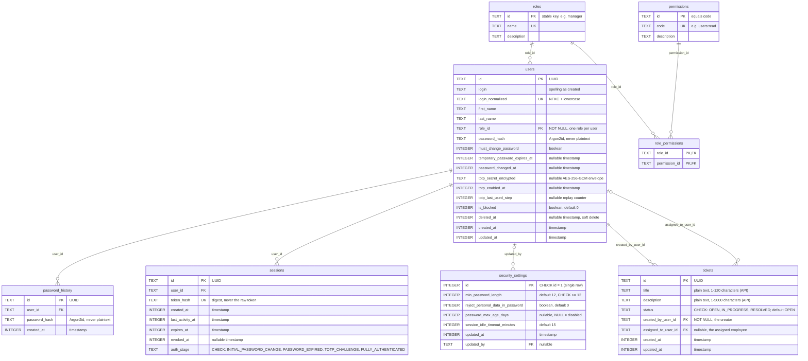
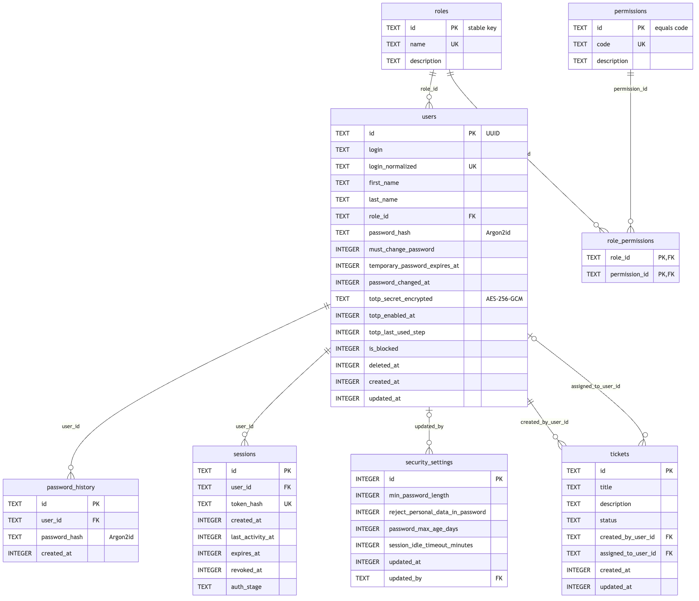

# Database Schema

SecureDesk stores its data in SQLite through [Drizzle ORM](https://orm.drizzle.team). This document describes the persistence **pipeline** (Task 1.2) and the **tables** (Task 1.3).

## Where things live

| What                     | Where (under `apps/backend/`)                            |
| ------------------------ | -------------------------------------------------------- |
| Schema (source of truth) | `src/server/db/schema/index.ts` (re-exports table files) |
| Generated migrations     | `src/server/db/migrations/` (committed)                  |
| Path resolution + checks | `src/server/db/config.ts`                                |
| Connection factory       | `src/server/db/connection.ts`                            |
| App singleton (`db`)     | `src/server/db/client.ts`                                |
| Migration runner         | `src/server/db/migrate.ts`, CLI `scripts/migrate.ts`     |
| Seed                     | `src/server/db/seeds/`, CLI `scripts/seed.ts`            |
| Reset                    | `src/server/db/reset.ts`, CLI `scripts/reset-db.ts`      |
| Constraint error mapping | `src/server/db/errors.ts`                                |
| Database files           | `data/` (git-ignored)                                    |

## Configuration

The file is chosen from the root `.env`:

| Variable             | Used when           | Default in `.env.example`       |
| -------------------- | ------------------- | ------------------------------- |
| `DATABASE_PATH`      | `NODE_ENV` ≠ `test` | `./data/securedesk.dev.sqlite`  |
| `TEST_DATABASE_PATH` | `NODE_ENV=test`     | `./data/securedesk.test.sqlite` |
| `E2E_DATABASE_PATH`  | Playwright run      | `./data/securedesk.e2e.sqlite`  |

Relative paths are resolved from `apps/backend`, which is the working directory of every npm script. Every entry point (`db:migrate`, `db:reset:*`, `db:generate`, the Next.js app) fails immediately with a readable message and a non-zero exit code when:

- the variable for the current mode is missing or blank;
- `DATABASE_PATH` and `TEST_DATABASE_PATH` resolve to the same file (tests would destroy development data);
- `:memory:` is used outside `NODE_ENV=test`;
- the path is inside any `public/` directory or inside `apps/frontend` (a web server could serve it).

## Connections

All connections are created by `openConnection()` in `connection.ts` with:

```text
journal_mode = WAL      concurrent readers while writing
foreign_keys = ON       enforced by the database itself (set explicitly on every connection)
busy_timeout = 5000     wait up to 5 s on a locked database instead of failing at once
```

`client.ts` exports the shared `db` and caches the connection on `globalThis`, so Next.js dev hot reloads reuse one connection instead of opening a new one per reload.

`db` is **lazy**: the database is opened on the first query, not when the module is imported. `next build` imports every route module, so an eager connection would make the build fail (and create a database file) in any checkout without `DATABASE_PATH`. The consequence is that a bad configuration is reported on the first query rather than at import time. Code that needs a connection to an explicit path (tests, scripts) should use `createDb()` / `openConnection()` from `connection.ts`.

## Migration workflow

Migrations are generated, committed and applied. They are never edited by hand.

1. Edit the schema under `src/server/db/schema/`.
2. `npm run db:generate` creates a new SQL file plus snapshot in `src/server/db/migrations/`. Review it and commit it with the schema change.
3. `npm run db:migrate` applies pending migrations to the dev database. Applied migrations are recorded in `__drizzle_migrations` and never replayed, so existing rows are kept. After applying, the runner executes `PRAGMA foreign_key_check` and fails if any row violates a foreign key.

Rules:

- **Append-only.** Never edit or delete a migration that has been committed; fix mistakes with a new migration.
- **No destructive migrations** (dropping tables/columns, deleting data). Prefer additive changes. Review any `DROP`, table-rebuild or `DELETE` statement the generator emits before committing it.
- The database file is never committed and never lives in a static directory.

## Resetting

```bash
npm run db:reset:dev      # removes the DATABASE_PATH file plus -wal and -shm
npm run db:migrate        # rebuilds the development schema from scratch
npm run db:reset:test     # removes the TEST_DATABASE_PATH file plus -wal and -shm
npm run db:migrate:test   # rebuilds the test schema from scratch (NODE_ENV=test)
```

The reset deletes only the resolved file and its two companions, prints each file it removed, and refuses to run when `NODE_ENV=production`. Resetting the test database never touches the development database (and vice versa). The two reset scripts pass `dev` or `test` to `scripts/reset-db.ts` instead of setting `NODE_ENV` inline: an inline `NODE_ENV=development` would overwrite a `production` set by the caller before the refusal could see it, and the scripts would delete the database anyway. `NODE_ENV` is only read by that refusal; the argument chooses the file.

To rebuild a machine from nothing: `npm ci`, `cp .env.example .env`, `npm run db:migrate`. For the test database: `npm run db:migrate:test`, then `npm run db:seed:test`.

## Errors returned to clients

`mapDbError(error)` in `errors.ts` converts known constraint violations into typed errors with fixed messages:

| SQLite code                    | Typed error      | Message                              |
| ------------------------------ | ---------------- | ------------------------------------ |
| `SQLITE_CONSTRAINT_UNIQUE`     | `ConflictError`  | `Resource already exists`            |
| `SQLITE_CONSTRAINT_PRIMARYKEY` | `ConflictError`  | `Resource already exists`            |
| `SQLITE_CONSTRAINT_FOREIGNKEY` | `ReferenceError` | `Referenced resource does not exist` |

`PRIMARYKEY` is mapped too because composite-key join tables (for example a role/permission link added twice) report duplicates with that code rather than `UNIQUE`.

Drizzle can wrap the driver error and put the SQLite code on `cause`, so the whole `cause` chain is searched. Raw SQL, table or column names and driver messages are never part of the mapped error. Any other error is returned unchanged and must be handled as an internal error (never serialized to a client).

`ReferenceError` deliberately keeps the name from the backlog, but it shadows the JavaScript global of the same name in any module that imports it. Import it under an alias (`import { ReferenceError as DbReferenceError }`) if the global is also needed.

## Seeding

```bash
npm run db:migrate && npm run db:seed        # development database
npm run db:migrate:test && npm run db:seed:test   # test database (NODE_ENV=test)
```

The seed (`src/server/db/seeds/`, entry point `scripts/seed.ts`) creates, in one transaction:

| What                | Content                                                                                                                 |
| ------------------- | ----------------------------------------------------------------------------------------------------------------------- |
| Roles               | Administrator, Manager (Kierownik), Employee (Pracownik), Guest (Gość), with stable ids from `ROLES`                    |
| Permissions         | the 16 codes of `PERMISSIONS`, linked to roles by the matrix in `src/server/permissions/matrix.ts` (22 links)           |
| `security_settings` | the single row: minimum length 12, personal-data rule off, expiry disabled, idle timeout 15 minutes                     |
| Accounts            | `ADMIN` (Administrator, System Administrator) plus `manager1`, `manager2`, `employee1`, `employee2`, `guest1`, `guest2` |

Rules:

- **Idempotent.** Roles, permissions, links and settings are inserted with `ON CONFLICT DO NOTHING`. An account that already exists (matched by `login_normalized`) is skipped: no password is generated for it and its `password_hash` is never read or changed, so re-running cannot overwrite a real credential. The links between roles and permissions are the exception: they are made to equal the matrix on every run, so a link that was dropped from `matrix.ts` is removed and a missing one is restored (an edited role name or description is not rewritten).
- **No stored secret.** The repository contains no password. Each new account gets a fresh credential from `issueTemporaryCredential()` (a 16-character CSPRNG password, hashed with Argon2id; see [architecture.md](architecture.md#temporary-passwords-variant-2)). Two seeds therefore never produce the same password or hash.
- **Demo tickets.** In development and test databases (any `NODE_ENV` except `production`) the seed also creates five tickets with fixed ids, one for each way a ticket can relate to the seed accounts (`src/server/db/seeds/tickets.ts`; who sees which one is in [permissions.md](permissions.md#who-sees-the-seeded-tickets)). A ticket that already exists is left exactly as it is, so a re-run never resets a status or an assignee that someone changed. In production the seed creates no tickets.
- **First login.** Every seeded account has `must_change_password = 1`. The six test users also get `temporary_password_expires_at` = the time the password was issued + 12 hours.
- **Delivery.** The plaintext of newly created accounts is appended to `apps/backend/.local/initial-credentials.txt` (git-ignored; directory `0700`, file `0600`). The seed prints that path and counts, never a password or hash. Delete the file once the passwords are changed. With `NODE_ENV=test` nothing is written to disk; `seedDatabase(db)` returns the passwords to the calling test.
- **Failure.** Before any account is created the seed checks that the credentials file can be written (or, when there is no file yet, its directory), so a permission problem aborts the run with nothing committed. A file that was made read-only on purpose is reported, not made writable. The check cannot see a disk that fills up between it and the write: the accounts then exist without a saved password, and the way out is the one described under ADMIN below. A failing run prints only the error message, and a test asserts that a failing insert never prints a hash or SQL, so a Drizzle upgrade that starts adding statements or parameters to error messages fails that test instead of leaking hashes to the console.

### ADMIN does not lapse after 12 hours

`ADMIN` is the one account no other administrator can reset, so its initial password has `temporary_password_expires_at = NULL`: it stays valid until ADMIN changes it, which is still forced at first login (`must_change_password = 1`). The login flow (Task 2.x) must therefore treat `must_change_password = 1` with a `NULL` expiry as "valid initial password, no deadline". The 12-hour rule remains mandatory for credentials issued through the admin panel (create user, reset password). That includes a reset of ADMIN itself, which the admin panel allows (only ADMIN can do it): the new password lapses after 12 hours like any other, and if it lapses unused nobody can issue another (see [User administration](architecture.md#user-administration)). If the credentials file is lost before the first login, there is no in-app recovery for ADMIN: run `npm run db:reset:dev && npm run db:migrate && npm run db:seed` on the development database.

This seed creates six test accounts and is meant for development and review databases. A production bootstrap that creates only `ADMIN` is not part of this task.

## Tables

Seven tables hold identity, authorization and session state, and `tickets` (Task 3.3) holds the support tickets. Types below are SQLite storage classes: "boolean" columns hold `0`/`1`, and every timestamp is an `INTEGER` of **UTC epoch milliseconds** (`integer(..., { mode: 'timestamp_ms' })` in Drizzle).



A test (`schema/er-diagram.test.ts`) migrates an empty database and fails if this diagram disagrees with it about tables, columns, types, primary keys, unique columns or foreign keys, so the diagram cannot silently go stale.

The report-ready export is generated from [`database-schema.mmd`](database-schema.mmd) and stored as
[`report-evidence/er-diagram.png`](report-evidence/er-diagram.png):



### Invariants and where they are enforced

| Invariant                                               | Enforced by                                                                                                                            |
| ------------------------------------------------------- | -------------------------------------------------------------------------------------------------------------------------------------- |
| Exactly one role per user                               | `users.role_id` is `NOT NULL` with a foreign key to `roles.id`                                                                         |
| A login is unique regardless of case or Unicode         | unique index on `users.login_normalized`, always filled with `normalizeLogin()` (`src/server/users/login.ts`)                          |
| Credentials are hashed; TOTP is authenticated-encrypted | password/history and session tokens are hashes; `users.totp_secret_encrypted` is AES-256-GCM, never plaintext                          |
| A session has one of four known auth stages             | `CHECK` on `sessions.auth_stage`                                                                                                       |
| Sessions can be revoked without deleting them           | `sessions.revoked_at`                                                                                                                  |
| One settings row; minimum password length never < 12    | `CHECK (id = 1)` and `CHECK (min_password_length >= 12)` on `security_settings`                                                        |
| A ticket has one creator, at most one assignee          | `tickets.created_by_user_id` is `NOT NULL`; both it and the nullable `assigned_to_user_id` are foreign keys to `users.id`              |
| A ticket has one of three known statuses                | `CHECK` on `tickets.status`                                                                                                            |
| Who may read or change a ticket                         | not the database: `src/server/tickets/policy.ts` decides, see [permissions.md](permissions.md)                                         |
| The permanent `ADMIN` account is protected              | triggers from migration `0001_protect_admin_account` (below) plus `assertNotProtectedAccount` in `src/server/users/account-service.ts` |
| Accounts are never hard-deleted by the application      | soft delete through `users.deleted_at`; foreign keys from sessions and history keep pointing at a real row                             |

### Notes

- **IDs.** `users`, `sessions`, `password_history` and `tickets` use UUIDs generated by the application. `roles.id` and `permissions.id` are stable keys (a role's id is its `ROLES` value, a permission's id is its code), so they are identical in every database and the seed can be re-run safely.
- **Login reservation.** `login_normalized` is unique across _all_ rows, including soft-deleted ones, so a deleted login cannot be re-registered by someone else.
- **Settings.** `updated_by` is `NULL` while the row still holds the seeded defaults.
- **Time.** Row timestamps default to `clock.now()` (`src/server/time/clock.ts`), so tests that replace the clock also control `created_at`/`updated_at`.
- **ADMIN triggers.** Migration `0001_protect_admin_account` was created with `drizzle-kit generate --custom` (the supported way to ship raw SQL; Drizzle does not model triggers). For the row where `login_normalized = 'admin'` it rejects `DELETE` and any `UPDATE` that changes `login`/`login_normalized` or `role_id`, sets `is_blocked` to non-zero, or sets `deleted_at`. Other columns, such as `password_hash`, stay writable. A trigger violation is reported by SQLite as `SQLITE_CONSTRAINT_TRIGGER`, which `mapDbError` deliberately does not translate: services must check the rule first and return their own error.
