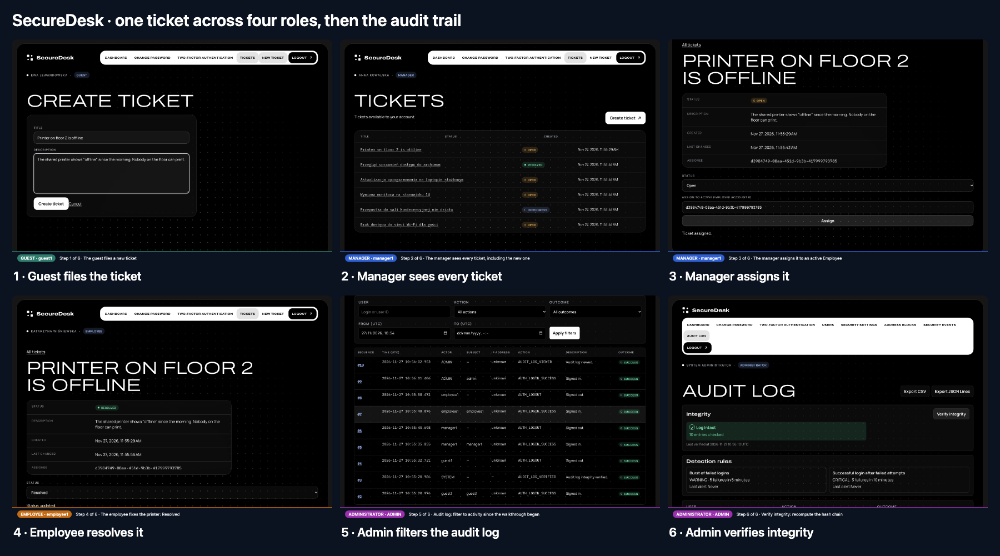
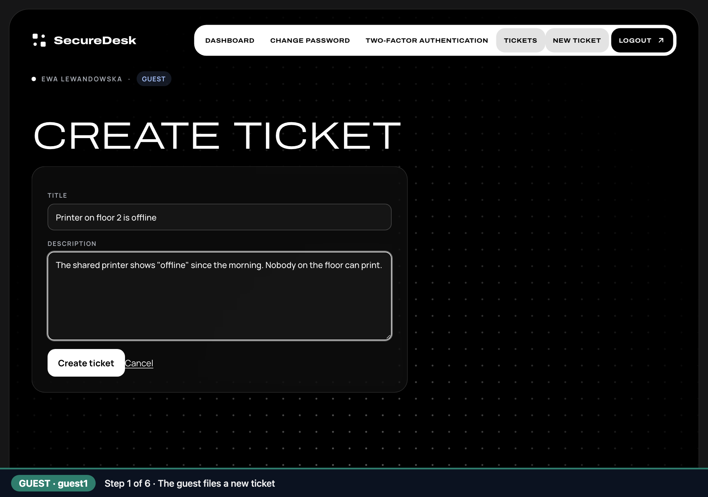
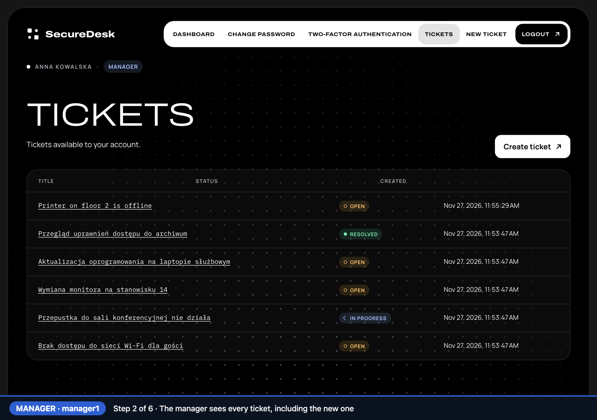
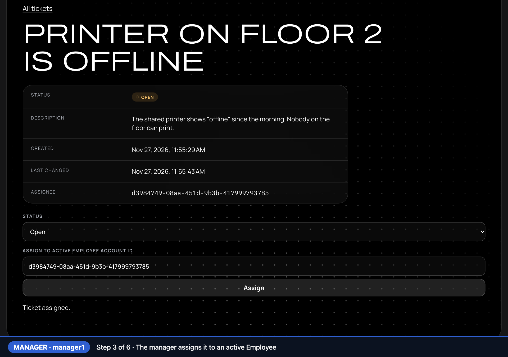
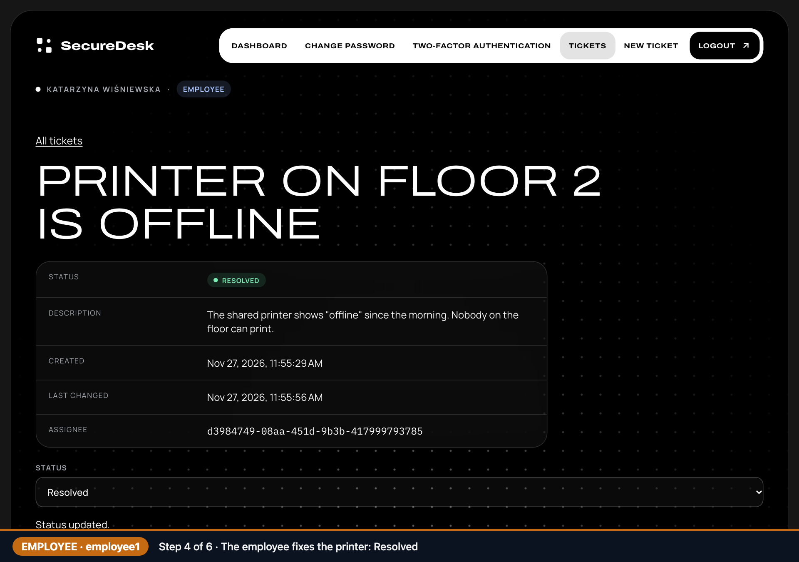
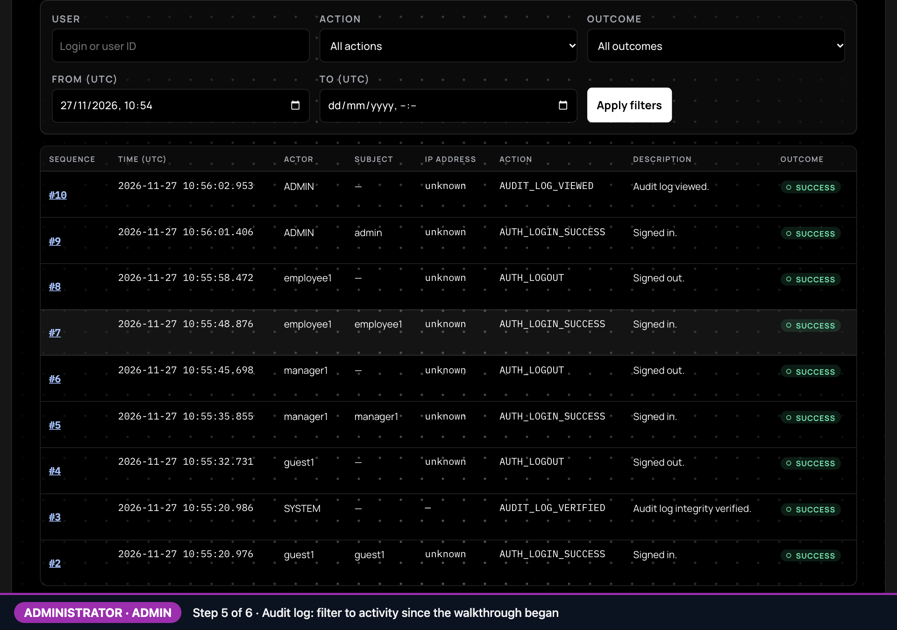
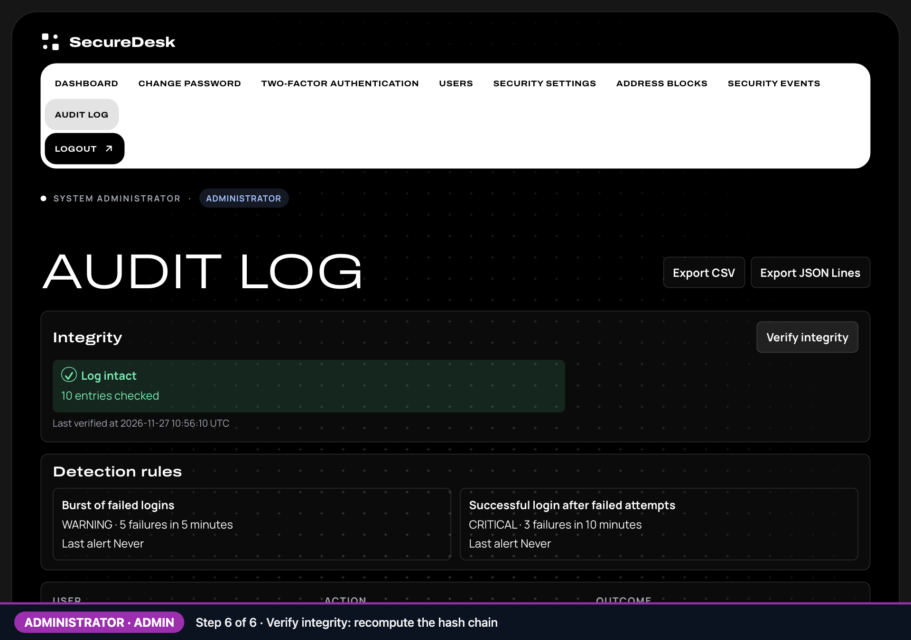

# Demonstrations

How to reproduce each demonstration of the project. For setup, see [running.md](running.md).

## Demo: one ticket, four roles, then the audit trail

[](report-evidence/demo/securedesk-ticket-workflow.webm)

**[Watch the 61-second recording](report-evidence/demo/securedesk-ticket-workflow.webm)**
(WebM, 1.7 MB, no audio). It is a real run of the app against a disposable SQLite database that
holds only synthetic accounts and tickets. A coloured bar at the bottom of the window names the
signed-in role and the current step, so every role switch is visible. You will see:

1. A **guest** signs in and files the ticket "Printer on floor 2 is offline". The guest's list
   contains only their own tickets.
2. A **manager** signs in, sees every ticket including the new one, and assigns it to `employee1`.
3. The assigned **employee** signs in, sees the ticket, sets it to _In progress_ and then _Resolved_.
4. The **administrator** signs in (the administrator has no ticket access), opens the audit log,
   filters it to the time window of the walkthrough and runs **Verify integrity**, which reports
   _Log intact_.

Notes on the recording: the login form shows its real CAPTCHA image, but the script typed the
test-only answer `TEST-SOLVED` (`CAPTCHA_TEST_MODE=true`, rejected in production) so the run could be
automated; in a normal run you type the characters of the image in reverse. Ticket creation,
assignment and status changes are not audit events (see the
[audit log runbook](audit-log.md)), so the filtered log shows the sign-ins and sign-outs of the
walkthrough, not the ticket edits themselves. Ticket timestamps are shown in the browser's local
time, audit timestamps in UTC.

| Step | Screenshot                                                                                                                                                                                                             | What it shows                                                                                                               |
| ---- | ---------------------------------------------------------------------------------------------------------------------------------------------------------------------------------------------------------------------- | --------------------------------------------------------------------------------------------------------------------------- |
| 1    |                                                                     | Any role with `tickets:create` may file a ticket. The creator is always the signed-in user and the status starts as _Open_. |
| 2    |                                                       | A manager reads every ticket. A guest saw only their own, an employee sees only created or assigned tickets.                |
| 3    |                                                  | Only a manager can assign, and only to an active Employee account.                                                          |
| 4    |                                                                | An employee may change the status of tickets assigned to them, not of other people's.                                       |
| 5    |  | The administrator filters the append-only audit log by time. The earlier database-seed entry is excluded.                   |
| 6    |                                                                | **Verify integrity** recomputes the hash chain over every entry and reports the result with a UTC timestamp.                |

## Reproduce the ticket walkthrough

1. Sign in as `guest1`, open **New ticket**, enter a title and description, and choose **Create ticket**.
2. Find `employee1`'s account ID. The UI shows it only in the address of the account page (Administrator
   → **Users** → `employee1`, the last path segment), or read it from the database:

   ```bash
   sqlite3 apps/backend/data/securedesk.dev.sqlite \
     "select id from users where login_normalized = 'employee1'"
   ```

3. Log out, sign in as `manager1`, open the ticket, paste the ID into **Assign to active Employee
   account ID** and choose **Assign**.
4. Log out, sign in as `employee1`, open the ticket and set the status to _In progress_, then _Resolved_.
5. Log out, sign in as `ADMIN`, open **Audit log**, set **From (UTC)** to the time you started and
   choose **Apply filters**, then choose **Verify integrity** and expect _Log intact_.

Try the boundaries too: as `guest1` the ticket list contains only your tickets; as `employee2` the
printer ticket answers `404`; as `ADMIN` there are no ticket pages and the API answers `403`.

## Reproduce the Module 2 demonstration (abuse defences)

1. Copy `.env.example`, generate the secrets as in [running.md](running.md#1-install-and-configure),
   migrate, seed and run the two applications. Leave the Canarytokens values empty for the offline
   demonstration.
2. On `/login`, omit or mistype the reversed-string proof to see the CAPTCHA refusal. Solve a new
   challenge and submit a wrong password five times to see the 15-minute account-lock countdown.
   Sign in as the seeded administrator and use the user detail page to unlock the account.
3. Sign in as a normal user, open `/account/change-password` and complete the Turnstile-controlled
   form. The automated equivalent additionally sends a forged proof directly to the API and records
   the real `403 CAPTCHA_FAILED` response.
4. Run `npm run bot-sim -- --target http://127.0.0.1:3000 --origin http://localhost:4200 --database
apps/backend/data/securedesk.e2e.sqlite` against the isolated E2E application. The script refuses
   non-local hosts without both explicit ownership consents.
5. Follow [`canarytokens.md`](canarytokens.md) for the live account-trap and AWS-key notifications.
   The local trap login, decoy access, administrator event view and bot matrix are reproduced by
   `npm run test:e2e:module2` without any third-party dependency.

## Reproduce the Module 3 demonstration (audit and detection)

1. After installing dependencies and Chromium, run `npm run test:e2e:module3 -- --evidence`.
   The runner seeds its own temporary SQLite database. It starts the local app on ports 3000
   and 4200 and the local Turnstile stub on 3100. Keep those ports free. The specs generate
   snapshot evidence in `report-evidence/module-3/` after a successful run.
2. The admin Audit log journey signs in with fixture accounts, generates a failed login,
   creates a user and saves a setting. The browser filters by user, time in UTC and action,
   displays both hashes, and downloads CSV and JSON Lines. The export audit entry records
   the applied filters and row count. For byte-preserving verification use JSON Lines.
3. The integrity journey runs **Verify integrity** with the keyboard. It records the intact result,
   changes a synthetic row in the disposable fixture, checks the reported sequence, restores the
   row and trigger, and confirms the chain is intact again. The [audit runbook](audit-log.md)
   shows how to run `npm run audit:tamper-demo` on temporary data and inspect the triggers with SQLite.
4. The detection journey generates both alert types, follows the critical alert to its audit range,
   acknowledges it, resets the target password and blocks the target account. The alert file is
   `alerts/security-alerts.jsonl` beside the database by default. The browser test reconciles its
   alert ID with the one in the audit drawer.

## Build the Polish report

Generate the evidence first, then build the PDF with the repository's ReportLab script:

```bash
python3 scripts/build-report.py --module 3 --date 27.11.2026 \
  --subtitle 'Raport z realizacji modułu 3 | Audyt i wykrywanie incydentów' \
  --source docs/course/report-module-3.md --output output/pdf/SecureDesk-raport-modul-3.pdf
```

The `output/` directory is git-ignored; attach finished PDFs to a release instead of committing them.
