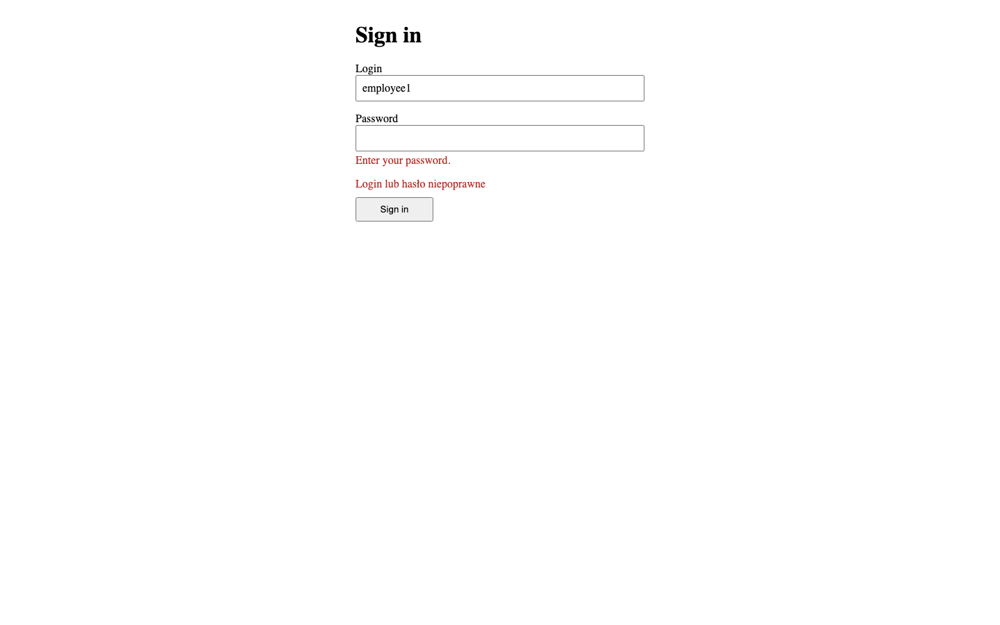
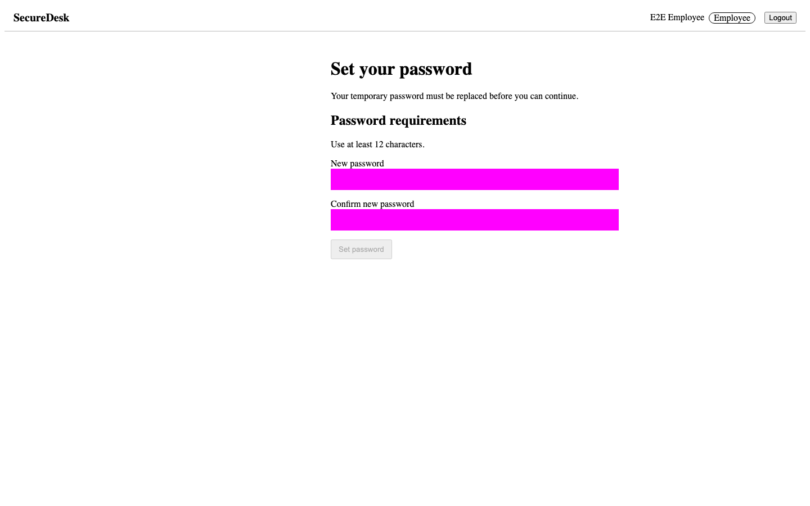
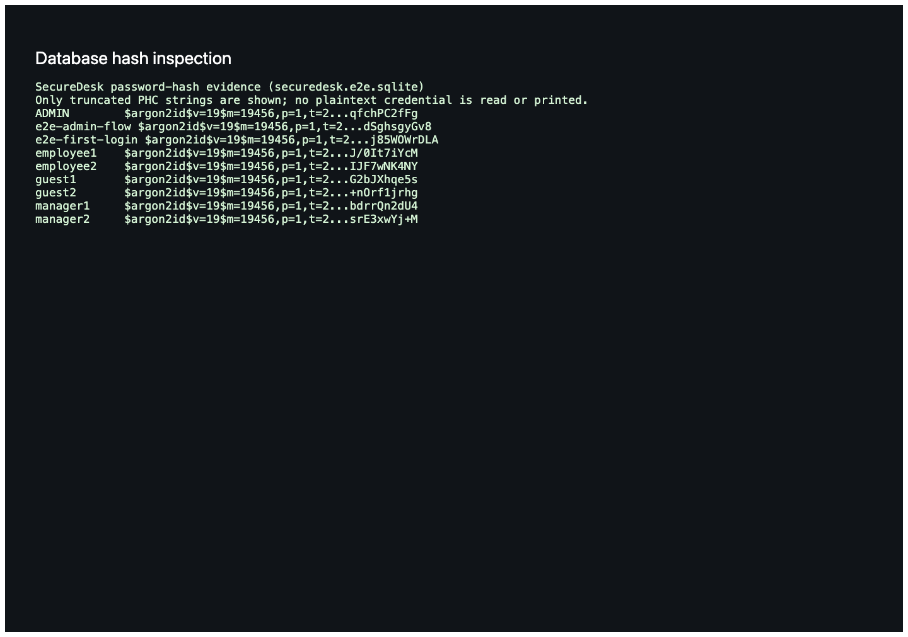
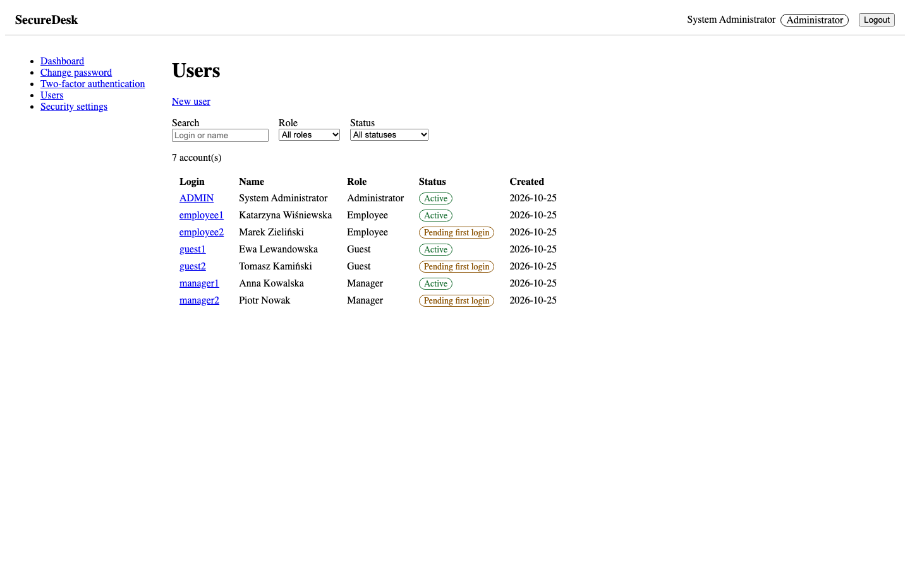
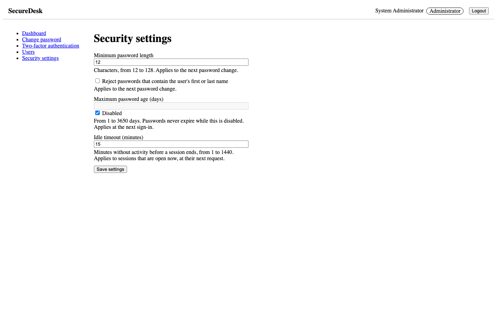
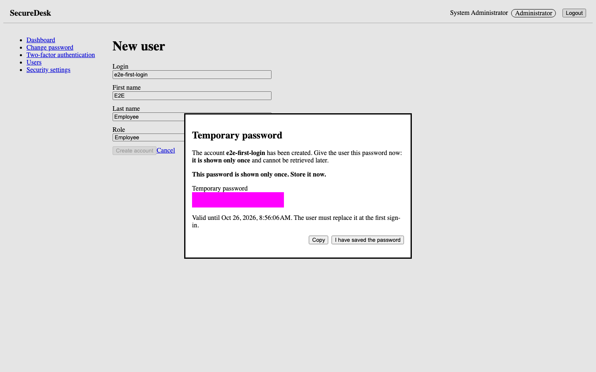
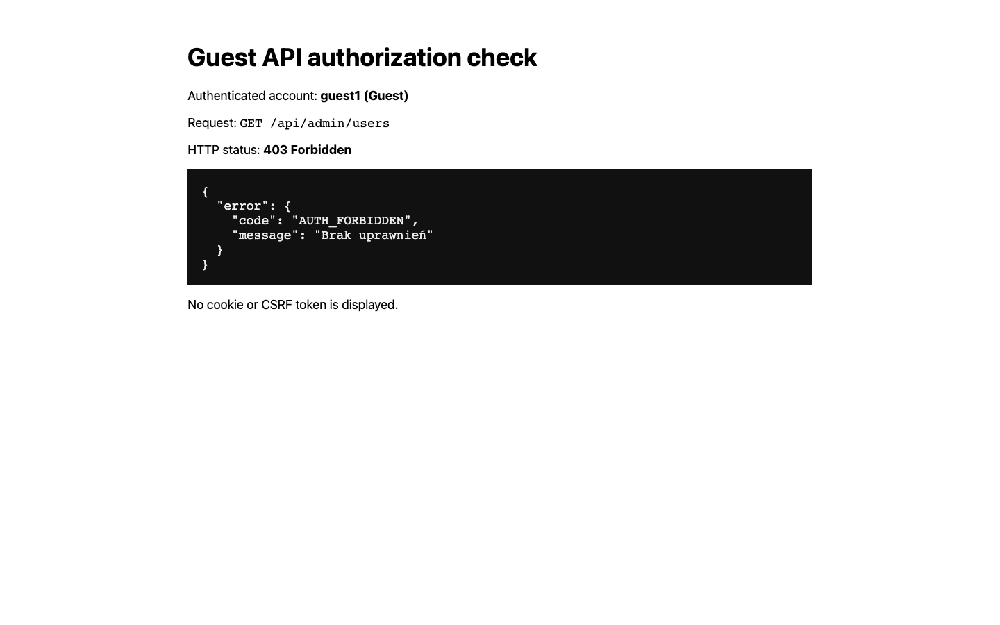
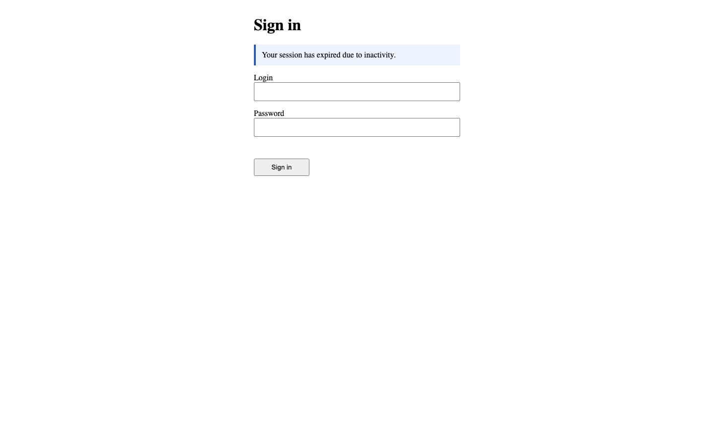

# SecureDesk

## Raport z realizacji modułu uwierzytelniania i autoryzacji

**Wariant:** 2  
**Autor:** Igor  
**Data opracowania:** 25.10.2026  
**Kod źródłowy:** https://github.com/IgorK834/SecureDesk

## Streszczenie

SecureDesk jest niewielką aplikacją helpdesk, której celem jest pokazanie kompletnego toru
bezpieczeństwa: od identyfikacji użytkownika, przez weryfikację hasła i utworzenie sesji, po
autoryzację operacji na poziomie roli i konkretnego obiektu. Projekt składa się z aplikacji Angular
oraz API Next.js korzystającego z SQLite. Zaimplementowano wymuszoną zmianę hasła tymczasowego,
historię haseł, panel administratora, ustawienia polityki, wygasanie sesji, CSRF, ograniczanie prób
logowania, demonstracyjne zgłoszenia oraz opcjonalne TOTP. Reguły bezpieczeństwa są egzekwowane w
API, a nie tylko w interfejsie.

Raport opisuje teorię, decyzje projektowe, wariant 2, schemat danych, macierz uprawnień, fragmenty
kodu i testy. Zrzuty ekranu powstały automatycznie w Playwright na izolowanej bazie E2E. Nie zawierają
użytecznych haseł, plików cookie ani tokenów.

# 1. Podstawy teoretyczne

## 1.1. Identyfikacja, uwierzytelnianie i autoryzacja

Identyfikacja jest deklaracją tożsamości. W SecureDesk użytkownik podaje login i mówi w ten sposób
systemowi, którym kontem chce się posłużyć. Sam login niczego jeszcze nie dowodzi. Uwierzytelnianie
jest sprawdzeniem dowodu tej deklaracji, najpierw hasła, a opcjonalnie także aktualnego kodu TOTP.
Autoryzacja zaczyna się dopiero po uwierzytelnieniu i odpowiada na pytanie, czy ta konkretna
tożsamość może wykonać żądaną operację.

Rozdzielenie tych pojęć ma znaczenie praktyczne. Poprawne hasło nie musi od razu oznaczać pełnego
dostępu. Sesja może mieć stan `INITIAL_PASSWORD_CHANGE`, `PASSWORD_EXPIRED` albo `TOTP_CHALLENGE`.
Użytkownik jest wtedy rozpoznany, ale ma ograniczony zestaw dozwolonych endpointów. Dopiero etap
`FULLY_AUTHENTICATED` pozwala ocenić uprawnienia biznesowe.

## 1.2. Haszowanie haseł i sól

Hasła nie powinny być szyfrowane w sposób odwracalny ani zapisywane jawnie. Serwer przechowuje wynik
jednokierunkowej funkcji do haseł i podczas logowania porównuje kandydata z zapisanym weryfikatorem.
SecureDesk używa Argon2id z parametrami pamięci 19456 KiB, dwóch przebiegów i równoległości 1.
Algorytm jest celowo kosztowny pamięciowo i obliczeniowo, dlatego masowe zgadywanie po wycieku bazy
jest droższe niż w przypadku szybkiego SHA-256. Konfiguracja odpowiada jednej z minimalnych
konfiguracji OWASP i jest jawnie zapisana w kodzie, aby jej zmiana była świadomą decyzją [1].

Biblioteka generuje niezależną losową sól o długości 16 bajtów dla każdego hasła. Sól nie jest
sekretem. Jej zadaniem jest sprawić, by dwa takie same hasła miały różne wyniki i by nie można było
efektywnie użyć jednej wcześniej obliczonej tablicy przeciw całej bazie. Format PHC przechowuje
wariant, wersję, parametry, sól i wynik. RFC 9106 zaleca unikalną sól i opisuje Argon2id jako wariant
łączący odporność na ataki kanałem bocznym z odpornością na kompromisy czas-pamięć [2].

## 1.3. Sesje

Po poprawnym uwierzytelnieniu serwer tworzy losowy 256-bitowy token. Przeglądarka dostaje go w
ciasteczku `HttpOnly`, natomiast baza przechowuje tylko skrót SHA-256 tokenu. W tym miejscu szybki
skrót jest właściwy, ponieważ token ma wysoką entropię i nie pochodzi ze słownika człowieka.
Skopiowanie bazy nie daje gotowego ciasteczka.

Sesja ma etap, czas utworzenia, ostatnią aktywność, termin bezwzględny i znacznik unieważnienia.
Każde autoryzowane żądanie sprawdza aktualny stan konta, etap i timeout odczytany z ustawień.
Wylogowanie, blokada, usunięcie, reset albo zmiana hasła unieważniają odpowiednie sesje po stronie
serwera. Token jest obracany, gdy zmienia się poziom dostępu, dzięki czemu stary token nie odzyskuje
uprawnień.

## 1.4. RBAC i polityka obiektowa

RBAC przypisuje uprawnienia roli zamiast powielać je przy każdym użytkowniku. W projekcie istnieją
role Administrator, Manager, Employee i Guest. Sam RBAC nie wystarcza dla zgłoszeń. Uprawnienie
`tickets:read:own` mówi, że rola może czytać własne zgłoszenia, ale warunek własności musi zostać
sprawdzony dla konkretnego rekordu. Dlatego lista jest filtrowana już w zapytaniu SQL, a odczyt
pojedynczego identyfikatora stosuje politykę obiektową.

Nieczytelne zgłoszenie zwraca takie samo 404 jak nieistniejące. Dzięki temu identyfikator nie staje
się wyrocznią ujawniającą istnienie cudzych danych. Ukrycie kontrolki w Angularze ma wyłącznie
znaczenie UX. Ostateczną decyzję zawsze podejmuje API.

# 2. Implementacja

## 2.1. Technologie i architektura

Frontend został wykonany w Angular 22 jako zestaw komponentów standalone z Reactive Forms. API to
Next.js 16 uruchamiany w środowisku Node.js, z route handlers zamiast interfejsu React. Dane zapisuje
SQLite przez Drizzle ORM, a migracje są wersjonowane. TypeScript działa w trybie ścisłym.

Vitest uruchamia testy jednostkowe, komponentowe i testy handlerów API z pokryciem V8. Playwright
uruchamia rzeczywistą przeglądarkę, osobną bazę, migracje i seed. Zod waliduje ścieżki, query i JSON.
Do haseł użyto biblioteki `argon2`, do TOTP `otplib`, a kod QR powstaje przez `qrcode`. Własna
implementacja prymitywu kryptograficznego nie jest częścią projektu.

Przeglądarka komunikuje się tylko ze wspólnym originem SPA. W developmencie Angular przekazuje
`/api` do Next.js. API nie emituje CORS. Mutacje przechodzą kontrolę Origin lub Referer oraz
sesyjny token XSRF. Nagłówki API ustawiają `no-store`, `nosniff`, `DENY`, politykę referrera, CORP i
CSP dla odpowiedzi API.

## 2.2. Wariant 2

Wariant 2 został odwzorowany w stałych i testach granicznych:

- minimalna długość hasła użytkownika wynosi 12 znaków Unicode, a administrator może ją podnieść;
- opcjonalna reguła odrzuca login, imię i nazwisko bez rozróżniania wielkości liter;
- seed tworzy sześciu użytkowników nieadministracyjnych: po dwóch Manager, Employee i Guest;
- istnieją cztery role: Administrator, Manager, Employee i Guest;
- hasło tymczasowe ma dokładnie 16 znaków, zawiera literę, cyfrę i znak specjalny;
- hasło tymczasowe jest ważne do chwili `issuedAt + 12h`, a od tej chwili jest wygasłe;
- bieżące hasło oraz pięć poprzednich wartości nie mogą zostać użyte ponownie.

Użytkownik z hasłem tymczasowym dostaje ograniczoną sesję. Nie może ominąć strony przez wpisanie
adresu panelu, ponieważ ograniczenie sprawdza `defineRoute`. Po zmianie hasła formularz jest
czyszczony, sesja obracana, a użytkownik trafia do pulpitu swojej roli.

## 2.3. Uzasadnienie Argon2id

Zwykły SHA-256 jest zaprojektowany jako szybki i łatwy do równoległego obliczania. Te cechy są dobre
dla integralności danych, ale złe dla haseł. Atakujący posiadający bazę może próbować bardzo wielu
kandydatów bez udziału serwera i bez limitu logowań. Argon2id wymusza koszt pamięci i czasu dla każdej
próby, więc podnosi koszt takiego ataku.

Parametry `m=19456`, `t=2`, `p=1` są jawne i zapisane razem z haszem w PHC. Wartości są punktem
wyjścia OWASP, a nie uniwersalną stałą na zawsze. Repozytorium zawiera benchmark i funkcję
`needsRehash`, dlatego wdrożenie może zmierzyć docelowy sprzęt, podnieść koszt i aktualizować słabsze
hasze po poprawnym logowaniu. RFC 9106 przedstawia silniejsze profile dla środowisk z większym
budżetem pamięci, więc parametry aplikacji należy traktować jako minimum dopasowane do projektu, nie
jako maksimum bezpieczeństwa [1][2].

## 2.4. Schemat ER


Najważniejsze relacje są proste i wymuszane kluczami obcymi. Użytkownik ma jedną rolę, a relacja
wiele-do-wielu `role_permissions` łączy role z kodami uprawnień. Historia i sesje należą do
użytkownika. Zgłoszenie ma twórcę i opcjonalnego przypisanego pracownika. Ustawienia bezpieczeństwa
mają jeden rekord, co jest wymuszone przez `CHECK id = 1`.

W tabeli użytkowników nie ma hasła jawnego. Pole `password_hash` zawiera PHC Argon2id, a opcjonalny
sekret TOTP jest kopertą AES-256-GCM. W sesji zapisany jest skrót tokenu, nigdy surowy token. Wszystkie
czasy są milisekundami UTC. Dokument `docs/database-schema.md` jest kontrolowany testem porównującym
diagram z bazą po migracjach.

## 2.5. Macierz uprawnień

| Operacja                               | Administrator | Manager | Employee | Guest |
| -------------------------------------- | ------------- | ------- | -------- | ----- |
| Użytkownicy: odczyt i administracja    | Tak           | Nie     | Nie      | Nie   |
| Reset hasła lub TOTP innego konta      | Tak           | Nie     | Nie      | Nie   |
| Globalne ustawienia bezpieczeństwa     | Tak           | Nie     | Nie      | Nie   |
| Zmiana własnego hasła                  | Tak           | Tak     | Tak      | Tak   |
| Utworzenie zgłoszenia                  | Nie           | Tak     | Tak      | Tak   |
| Odczyt wszystkich zgłoszeń             | Nie           | Tak     | Nie      | Nie   |
| Odczyt przypisanych zgłoszeń           | Nie           | Tak     | Tak      | Nie   |
| Odczyt własnych zgłoszeń               | Nie           | Tak     | Tak      | Tak   |
| Przypisanie zgłoszenia                 | Nie           | Tak     | Nie      | Nie   |
| Zmiana statusu dowolnego zgłoszenia    | Nie           | Tak     | Nie      | Nie   |
| Zmiana statusu przypisanego zgłoszenia | Nie           | Tak     | Tak      | Nie   |

Macierz realizuje najmniejsze uprawnienia. Administrator zarządza tożsamościami i polityką, lecz
celowo nie czyta treści zgłoszeń. Manager organizuje pracę nad wszystkimi zgłoszeniami, ale nie może
zmieniać kont. Employee widzi to, co utworzył lub co mu przypisano, i zmienia status wyłącznie
przypisanej pracy. Guest tworzy i czyta tylko własne zgłoszenia.

Reset TOTP jest uprawnieniem administratora, ale wymaga opisanej procedury potwierdzenia tożsamości
poza aplikacją. Samo posiadanie sesji administratora nie jest dowodem tożsamości osoby proszącej o
odzyskanie dostępu.

## 2.6. Przepływ logowania i ochrona przed enumeracją

Formularz używa pola `type=password`, właściwych atrybutów `autocomplete`, etykiet i regionu
`aria-live`. Enter wysyła formularz. Sygnał `submitting` blokuje drugi request. Hasło nie trafia do
URL, router state, Web Storage ani logu i jest czyszczone po każdym błędzie.

Nieznany login, złe hasło, konto zablokowane i konto usunięte mają ten sam wynik. Dla nieznanego
loginu wykonywana jest rzeczywista weryfikacja Argon2id względem hasza atrapowego, co ogranicza
różnicę czasową. Limiter liczy przesłany, znormalizowany tekst loginu przed wyszukaniem konta. Szósta
porażka dla kombinacji IP i loginu w 15 minut daje neutralne 429 z `Retry-After` niezależnie od
istnienia konta.

## 2.7. CSRF, parsing i nagłówki

Token XSRF jest HMAC-SHA256 identyfikatora sesji pod kluczem `CSRF_SECRET` i jest porównywany w
stałym czasie. Mutacje z sesją wymagają zgodnego ciasteczka i nagłówka. Dodatkowo Origin lub Referer
musi dokładnie odpowiadać `APP_ORIGIN`. Logowanie nie ma jeszcze sesji, dlatego opiera się na kontroli
originu i obowiązkowym `application/json`, czyli żądaniu niesimple.

Parser odrzuca treść większą niż 16384 bajty kodem 413 i nie-JSON kodem 415. Zod zwraca jedynie
dozwolony kształt 400. Nieobsłużony wyjątek daje ogólne `500 INTERNAL_ERROR` bez stosu, SQL i ścieżki.
Drizzle parametryzuje zapytania, a lint zabrania `sql.raw` i interpolowanego SQL poza migracjami.

## 2.8. Opcjonalne TOTP

Po aktywacji TOTP samo hasło tworzy tylko sesję `TOTP_CHALLENGE`. Taka sesja może odczytać `/me`,
wylogować się i wysłać kod, lecz każdy endpoint chroniony zwraca `AUTH_TOTP_REQUIRED`. Poprawny kod
obraca sesję do `FULLY_AUTHENTICATED`.

Sekret powstaje w `otplib`, a API zwraca URI `otpauth` jeden raz podczas rozpoczęcia zapisu. Angular
rysuje kod QR i czyści URI po opuszczeniu komponentu. Baza przechowuje sekret zaszyfrowany
AES-256-GCM z niezależnym 32-bajtowym kluczem środowiskowym. Akceptowany jest aktualny krok z
odchyleniem jednego kroku, ale licznik ostatnio użytego kroku blokuje replay. Pięć błędów na sesję w
15 minut wyczerpuje limit. Wyłączenie wymaga bieżącego hasła i świeżego kodu.

## 2.9. Wybrane fragmenty kodu

Poniższe skrócone fragmenty pokazują punkty, w których reguła staje się wykonującym się kodem. Nie
zawierają danych uwierzytelniających.

### Haszowanie

```typescript
export const ARGON2_OPTIONS = {
  type: argon2.argon2id,
  memoryCost: 19456,
  timeCost: 2,
  parallelism: 1,
} as const;

export async function hashPassword(plain: string): Promise<string> {
  if (!isAcceptablePassword(plain)) throw new InvalidPasswordInputError();
  return argon2.hash(plain, ARGON2_OPTIONS);
}
```

### Walidacja nowego hasła

```typescript
export function validateNewPassword(password, user, settings): PasswordViolation[] {
  const violations: PasswordViolation[] = [];
  const length = Array.from(password).length;
  if (length < Math.max(12, settings.minPasswordLength)) violations.push('TOO_SHORT');
  if (length > 128) violations.push('TOO_LONG');
  const comparable = password.normalize('NFKC').toLowerCase();
  if (settings.rejectPersonalDataInPassword) {
    if (includesPersonalData(comparable, user.login)) violations.push('CONTAINS_LOGIN');
    if (includesPersonalData(comparable, user.firstName)) violations.push('CONTAINS_FIRST_NAME');
    if (includesPersonalData(comparable, user.lastName)) violations.push('CONTAINS_LAST_NAME');
  }
  if (BANNED_PASSWORDS.has(comparable)) violations.push('COMMON_PASSWORD');
  return violations;
}
```

### Hasło tymczasowe

```typescript
export function generateTemporaryPassword(): string {
  const characters = [pick(LETTERS), pick(DIGITS), pick(SPECIALS)];
  while (characters.length < 16) characters.push(pick(POOL));
  for (let i = characters.length - 1; i > 0; i--) {
    const j = randomInt(i + 1);
    [characters[i], characters[j]] = [characters[j], characters[i]];
  }
  return characters.join('');
}

export function isTemporaryPasswordExpired(expiresAt: Date, now: Date): boolean {
  return now.getTime() >= expiresAt.getTime();
}
```

### Rozwiązanie sesji

```typescript
export function resolveSession(db, token): ResolvedSession | null {
  if (typeof token !== 'string' || !TOKEN_PATTERN.test(token)) return null;
  const rows = loadSessionUserAndPermissions(db, hashSessionToken(token));
  const first = rows[0];
  if (!first || first.session.revokedAt !== null) return null;
  const idleMs = readSecuritySettings(db).sessionIdleTimeoutMinutes * 60_000;
  const unusable =
    first.user.deletedAt !== null ||
    first.user.isBlocked ||
    clock.now().getTime() >= first.session.expiresAt.getTime() ||
    clock.now().getTime() - first.session.lastActivityAt.getTime() >= idleMs;
  if (unusable) {
    revokeSession(db, first.session.id);
    return null;
  }
  return mapResolvedSession(rows);
}
```

### Wspólny wrapper tras

```typescript
const session =
  auth === 'public'
    ? undefined
    : requireStage(request, auth.stages, { permission: auth.permission });
assertCsrfProtection(request, session?.session);
if (session) touchSession(db, session.session.id);
const context = {
  params: params && parseInput(params, await segment?.params),
  query: query && parseInput(query, Object.fromEntries(request.nextUrl.searchParams)),
  body: body && (await parseJsonBody(request, body)),
};
return await handler(context);
```

# 3. Dowody działania

## 3.1. Błędne logowanie



Playwright wysyła osobno złe hasło dla znanego loginu i hasło dla nieznanego loginu. Oba przypadki
pokazują dokładnie `Login lub hasło niepoprawne`. Dowód nie pozwala rozpoznać, czy konto istnieje.

## 3.2. Wymuszona zmiana hasła



Administrator utworzył Employee, a jego pierwsze logowanie zakończyło się etapem
`INITIAL_PASSWORD_CHANGE`. Próba wejścia na pulpit nie omija ograniczenia. Pola hasła są maskowane na
zrzucie, a po sukcesie formularz jest zerowany i sesja obracana.

## 3.3. Hasze w bazie



Skrypt odczytuje izolowaną bazę i pokazuje jedynie obcięte prefiksy PHC. Widoczny jest
`$argon2id$v=19$` oraz różne sole. Obcięcie uniemożliwia wykorzystanie dowodu jako weryfikatora, a
brak tekstu jawnego potwierdza model przechowywania.

## 3.4. Panel administratora



Lista pokazuje status i rolę oraz prowadzi do tworzenia, edycji, blokady, usunięcia i resetu hasła.
Działania destrukcyjne wymagają jawnego potwierdzenia. Operacje chronionego `ADMIN` są wyłączone w UI
i niezależnie od tego odrzucane przez API.



Formularz zapisuje minimalną długość, regułę danych osobowych, ważność haseł i timeout bezczynności.
Po odświeżeniu wartości pochodzą z serwera. Walidacja API pozostaje autorytatywna.

## 3.5. Jednorazowe hasło tymczasowe



Dialog pokazuje 16-znakową wartość tylko bezpośrednio po utworzeniu lub resecie. Na dowodzie pole jest
zamaskowane. Po zamknięciu sygnał komponentu jest czyszczony, ponowne otwarcie rekordu nie pokazuje
wartości, a test sprawdza DOM, URL oraz oba Web Storage.

## 3.6. HTTP 403 dla Guest



To nie jest przekierowanie UI. Test loguje prawidłowego Guest i z tego samego kontekstu przeglądarki
wykonuje `GET /api/admin/users`. API rozpoznaje sesję, stwierdza brak `users:read` i zwraca 403 bez
danych listy. Cookie i token XSRF nie są wyświetlone.

## 3.7. Wylogowanie po bezczynności



Test ustawia timeout na minutę, czeka około 65 sekund i dopiero wtedy wykonuje akcję. To następne
żądanie dostaje 401, stan klienta jest czyszczony, a login pokazuje neutralny komunikat. Frontend nie
odpytuje `/me` i nie używa timera jako kontroli bezpieczeństwa.

# 4. Odpowiedzi na pytania kontrolne

## 4.1. Dlaczego nie należy tworzyć własnej kryptografii? Jakie dwa błędy są łatwe?

Prymitywy kryptograficzne mają wymagania, których poprawność trudno ocenić zwykłym testem
funkcjonalnym. Implementacja może działać dla przykładu, a jednocześnie przeciekać przez timing,
losować z rozkładem obciążonym albo błędnie składać nonce, tag i ciphertext. Dojrzała biblioteka ma
recenzowany algorytm, wektory testowe i poprawki bezpieczeństwa. Dwa proste błędy to użycie
`Math.random()` do haseł lub tokenów oraz ponowne użycie IV/nonce w AES-GCM. Inne typowe błędy to
zwykłe porównanie MAC zamiast porównania stałoczasowego i pominięcie weryfikacji tagu. W SecureDesk
Argon2id i TOTP są delegowane do bibliotek, losowość pochodzi z `node:crypto`, a lokalny kod jedynie
łączy prymitywy według wąskiego, testowanego kontraktu.

## 4.2. Dlaczego SHA-256 nie nadaje się do haseł i po co jest sól?

SHA-256 ma być szybki. Atakujący po wycieku bazy może liczyć ogromną liczbę kandydatów offline, bez
rate limitu. Argon2id ma regulowany koszt pamięci i czasu, przez co każda próba jest droższa, a sprzęt
równoległy ma mniejszą przewagę. Sól jest losową, unikalną wartością dołączoną do każdego hasła.
Powoduje różne hasze tych samych haseł, blokuje proste tablice tęczowe i wymusza pracę osobno dla
każdego rekordu. Sól nie ukrywa słabego hasła i może być przechowywana obok hasza. SHA-256 jest za to
odpowiedni do losowego 256-bitowego tokenu sesji, bo token nie ma małej, ludzkiej przestrzeni
kandydatów.

## 4.3. Jak NIST traktuje reguły złożoności i okresowe zmiany?

NIST SP 800-63B-4 odradza, a w aktualnych wymaganiach zabrania narzucania reguł typu obowiązkowa
wielka litera, cyfra i znak specjalny dla haseł wybieranych przez człowieka. Użytkownicy spełniają je
przewidywalnie, na przykład dopisując `1!`, co podnosi koszt poznawczy bardziej niż odporność. NIST
nie zaleca też arbitralnych okresowych zmian bez sygnału kompromitacji, ponieważ prowadzą do małych,
przewidywalnych modyfikacji poprzedniego hasła [3]. Lepsze są długość, lista wartości powszechnych,
rate limiting, menedżer haseł i zmiana po dowodzie naruszenia. Projekt zachowuje konfigurowalny okres
ważności, bo wymaga go zadanie, i uczciwie opisuje ten kompromis. Reguła grup znaków dotyczy wyłącznie
losowo generowanego hasła tymczasowego, nie hasła wymyślanego przez człowieka.

## 4.4. Dlaczego ukrycie przycisku nie jest autoryzacją?

Kod frontendu działa na urządzeniu użytkownika i może zostać zmieniony, pominięty albo zastąpiony
`curl`, narzędziami deweloperskimi czy własnym klientem HTTP. Ukryty przycisk informuje uczciwego
użytkownika, co ma sens, lecz nie blokuje żądania. Autoryzacja musi działać przy granicy z chronionym
zasobem, czyli w API, na podstawie zaufanej sesji, aktualnych uprawnień i warunku obiektowego. W
SecureDesk Guest nie widzi nawigacji administratora, ale ważniejszy dowód to ręczne żądanie z jego
prawidłowym cookie zakończone 403. Podobnie wyłączone operacje `ADMIN` nadal dostają 409 po
sfałszowanym wywołaniu.

# 5. Testowanie i wyniki

Testy jednostkowe pokrywają granice 11/12/13 i 128/129 znaków, Unicode, dane osobowe w różnych
wielkościach liter, historię pięciu haseł oraz 1000 próbek generatora. Fake clock dowodzi, że
11h59m59.999s jest ważne, a dokładnie 12h jest wygasłe. Mutacje minimum z 12 na 11, operatora `>=` na
`>` oraz usunięcie `toLowerCase()` powodują nazwane błędy testów.

Testy API budują `Request`, używają ciasteczkowego klienta i świeżych baz SQLite. Obejmują logowanie,
restricted sessions, zmiany haseł, każdą trasę admina dla czterech ról, unieważnianie, restart,
CSRF, limity i współbieżność. Skrypt traceability odrzuca brak identyfikatora SEC-01 do SEC-30 w
nazwie testu. Pełny `npm test` utrzymuje próg 80 procent dla linii, instrukcji, funkcji i gałęzi.

Playwright działa z jednym workerem i bez retry. Global setup tworzy losowe dane dostępowe w pliku
ignorowanym przez Git. Zestaw wykonuje osiem testów, w tym wolny SEC-22. Trzy kolejne pełne przebiegi
są kontrolą deterministyczności, a zrzuty są nadpisywane wyłącznie rzeczywistym stanem aplikacji.

# 6. Różnice i świadome decyzje

- Oprócz sześciu nieadministracyjnych kont testowych seed tworzy chronione konto `ADMIN`. Jest ono
  kontem odzyskiwania i nie może zostać zablokowane, usunięte ani zdegradowane.
- Historia obejmuje bieżące hasło i pięć poprzednich haszy. Głębokość pięciu jest decyzją projektową.
- Domyślne minimum to 12, reguła danych osobowych jest wyłączona, okresowa ważność hasła wyłączona,
  a timeout bezczynności wynosi 15 minut. Administrator może zmienić ustawienia w dozwolonych
  granicach.
- Administrator jest celowo wyłączony z treści zgłoszeń. Zarządzanie kontami nie daje dostępu do
  danych biznesowych helpdesku.
- Wymagany okres ważności hasła jest dostępny, chociaż współczesne wytyczne NIST nie zalecają
  rutynowych zmian bez dowodu kompromitacji.
- TOTP jest dodatkiem. Nie zastępuje hasła i nie osłabia wymuszonej zmiany hasła tymczasowego.

# 7. Ograniczenia i dalsza praca

Limiter jest mapą w pamięci jednego procesu. Restart zeruje liczniki, a skalowanie horyzontalne
wymaga wspólnego magazynu z atomowymi operacjami. SQLite dobrze pasuje do demonstracji i jednego
procesu, ale nie zapewnia klastra wysokiej dostępności. Produkcja wymaga reverse proxy z HTTPS i
HSTS, zarządzania kluczami, szyfrowanych backupów, monitoringu oraz rotacji sekretów.

Głębokość historii pięciu oraz domyślne 15 minut są wyborami, nie uniwersalnymi wartościami.
Opcjonalne TOTP nie ma kodów odzyskiwania; recovery administratora wymaga procedury organizacyjnej.
TOTP nie jest phishing-resistant, więc dla środowiska o wyższym ryzyku kolejnym krokiem byłby
WebAuthn. Aplikacja nie udaje pełnego systemu helpdesk: nie ma załączników, rich text ani integracji,
co celowo ogranicza powierzchnię ataku.

# 8. Wnioski

Najważniejszym wynikiem projektu nie jest pojedynczy formularz, lecz spójność warstw. To samo żądanie
przechodzi kontrolę parsera, sesji, etapu, uprawnienia, CSRF i walidacji, zanim dotknie logiki
biznesowej. Odmowa w UI ma odpowiednik w API, a stan w bazie rozstrzyga o wygaśnięciu i unieważnieniu.
Neutralne błędy zmniejszają enumerację, Argon2id ogranicza skutki wycieku, a testy graniczne wiążą
kod z wariantem 2.

Automatyczna dokumentacja dowodowa jest równie ważna jak implementacja. Zrzuty powstają na świeżej
bazie, scenariusze mają nazwy SEC, a raport nie kopiuje sekretów. Pozostałe ograniczenia są jawne,
więc projekt można ocenić jako kompletną demonstrację akademicką bez przedstawiania go jako gotowego
produktu produkcyjnego.

# 9. Źródła i załącznik

1. OWASP, Password Storage Cheat Sheet:
   https://cheatsheetseries.owasp.org/cheatsheets/Password_Storage_Cheat_Sheet.html
2. RFC 9106, Argon2 Memory-Hard Function:
   https://www.rfc-editor.org/rfc/rfc9106.html
3. NIST SP 800-63B-4, Authentication and Authenticator Management:
   https://pages.nist.gov/800-63-4/sp800-63b.html
4. Angular, Security guidance:
   https://angular.dev/best-practices/security
5. Kod źródłowy projektu:
   https://github.com/IgorK834/SecureDesk

Pełna instrukcja odtworzenia znajduje się w `README.md`. Macierz jest utrzymywana w
`docs/permissions.md`, model zagrożeń w `docs/threat-model.md`, a mapa testów w `docs/testing.md`.
